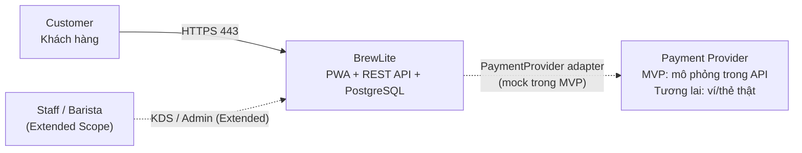
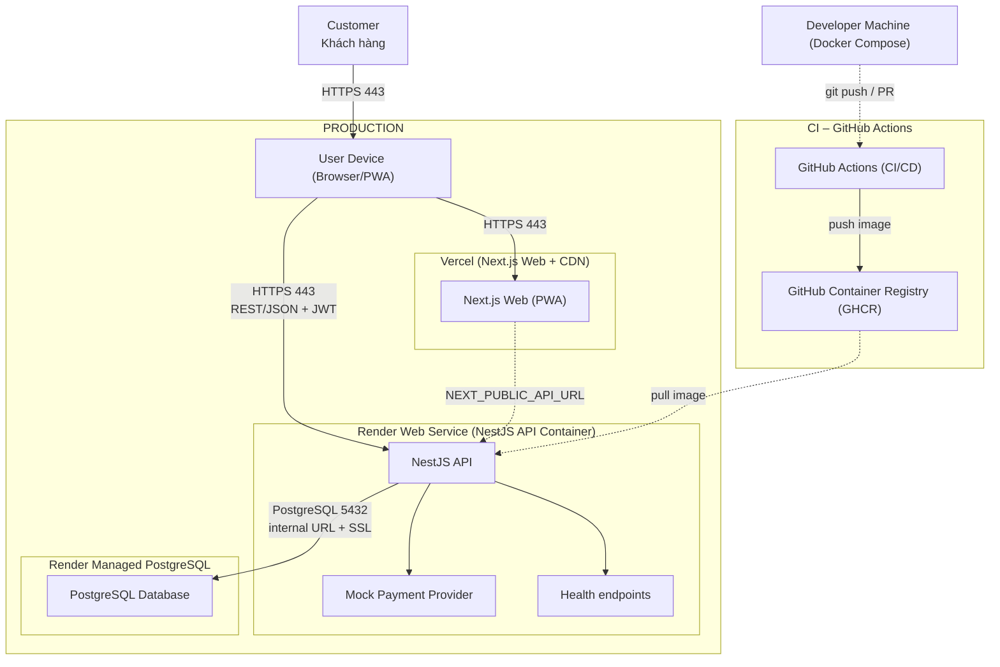
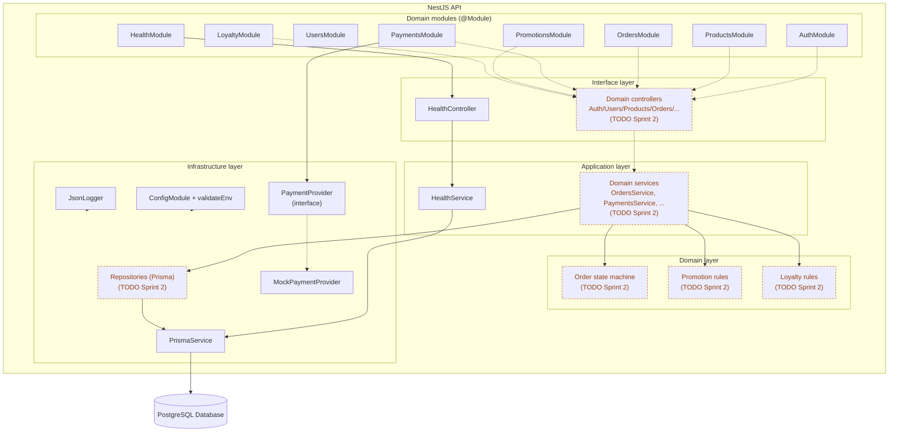
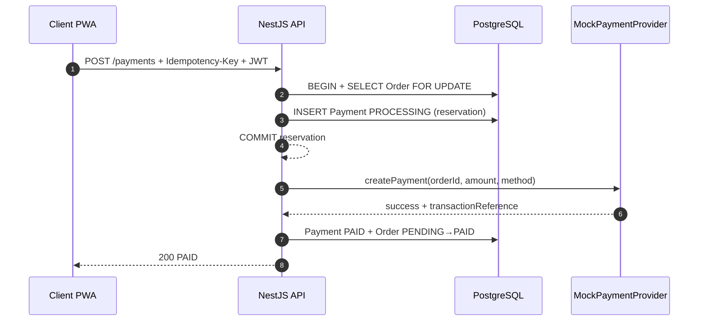

# Kiến trúc hệ thống BrewLite

- **Task**: 3 – Thiết kế kiến trúc (Task 3.1 + 3.2)
- **Ngày**: 2026-10-19
- **Nguồn yêu cầu**: `docs/requirements/context-and-scope.md`, `docs/requirements/srs.md`, `docs/requirements/use-case-checkout.md`
- **Nguồn mã nguồn**: repo hiện tại (skeleton Task 3). Các phần chưa code được đánh dấu **TODO Sprint 2**.
- **Trạng thái hạ tầng**: production **chưa deploy**; xem `docs/architecture/deployment.md`.

## 1. Tổng quan và mục tiêu chất lượng

BrewLite là PWA mobile-first cho khách hàng đặt đồ uống, chọn size/topping, thanh toán không tiền mặt và nhận tại quầy. MVP gồm: menu, chi tiết món, giỏ hàng, đăng ký/đăng nhập, tạo đơn, thanh toán mô phỏng, xác nhận và lịch sử đơn. Nhân viên/quản lý (KDS, quản lý món) thuộc **Extended Scope**.

Hệ thống chọn **modular monolith**: một Next.js web, một NestJS API chia module theo domain, một PostgreSQL. Không có microservices, message queue hay Kubernetes.

| Mục tiêu chất lượng | Cách đáp ứng trong thiết kế | Truy vết |
| :--- | :--- | :--- |
| Đơn giản, dễ giải thích | 1 API + 1 DB + 1 web; module theo domain; không thêm hạ tầng trung gian | ADR-001, ADR-002 |
| Dễ deploy | Docker multi-stage; GHCR; Render pull image; Vercel deploy Next.js | ADR-006, `deployment.md` |
| Dễ trace | Mã FR/NFR/UC từ Task 1; bảng truy vết ở §9; tên node thống nhất C4 ↔ deployment | §9, `docs/traceability-matrix.md` |
| Toàn vẹn dữ liệu | Transaction + `SELECT FOR UPDATE`, idempotency key, unique constraint trong Prisma schema | FR-05, FR-06, NFR-05 |
| Bảo mật cơ bản | Bcrypt + JWT (kế hoạch), `class-validator`, secret qua dashboard, không commit `.env` | FR-04, NFR-02, ADR-008 |
| Vận hành tối thiểu | JSON log ra stdout, `/health`, `/health/ready`, validate env khi khởi động | FR-14, ADR-007 |

**Quy ước trạng thái trong tài liệu**

| Nhãn | Nghĩa |
| :--- | :--- |
| **Đã có** | Có file/code trong repo và đã build/test được ở local |
| **Khung** | Có module/interface nhưng chưa có nghiệp vụ |
| **TODO Sprint 2** | Chưa có code; chỉ là thiết kế. Trong tài liệu này **TODO Sprint 2 = TODO: chưa có trong repo**. |
| **Kế hoạch** | Chưa tạo trên nền tảng cloud |

> Nhóm N người và thời hạn X ngày **chưa được ghi trong repo/tài liệu** – cần nhóm điền. Thiết kế dưới đây giả định quy mô đồ án, một instance API, lưu lượng thấp.

## 2. Sơ đồ C4

### 2.1 Level 1 – Context

- Trong MVP, `MockPaymentProvider` nằm **bên trong** NestJS API, không phải service mạng riêng.
- `Payment Provider` bên ngoài chỉ là điểm thay thế tương lai; xem ADR-005.

### 2.2 Level 2 – Container

Tên container/nền tảng dưới đây được dùng **nguyên văn** trong deployment diagram và bảng truy vết §9.

| Container/nền tảng | Trách nhiệm | Công nghệ |
| :--- | :--- | :--- |
| `Next.js Web (PWA)` | UI mobile-first, giỏ hàng client, gọi REST API, manifest + service worker | Next.js 16 App Router, React 19, TypeScript |
| `NestJS API` | REST API, xác thực, nghiệp vụ đơn/thanh toán, health, log | NestJS 11, Prisma 6.19.3 |
| `PostgreSQL Database` | Dữ liệu giao dịch, ràng buộc unique/khóa | PostgreSQL (local 16; Render theo dashboard) |
| `Mock Payment Provider` | Mô phỏng thành công/thất bại, trả `transactionReference` | TypeScript, DI token `PAYMENT_PROVIDER` |
| `Health endpoints` | Liveness/readiness cho deploy và smoke test | NestJS controller |
| `Vercel (Next.js Web + CDN)` | Hosting + CDN + HTTPS cho web | Vercel |
| `Render Web Service (NestJS API Container)` | Chạy container API, inject env/secret, thu log | Render |
| `Render Managed PostgreSQL` | DB managed, persistent storage, không public | Render |
| `GitHub Actions (CI/CD)` | Lint/test/build, build image, deploy hook, smoke test | GitHub Actions |
| `GitHub Container Registry (GHCR)` | Lưu image API theo commit SHA/semver | GHCR |
| `Developer Machine (Docker Compose)` | Môi trường local web + API + DB | Docker Compose |

### 2.3 Level 3 – Component (NestJS API)

**Đã có trong repo**

| Thành phần | Đường dẫn |
| :--- | :--- |
| Wiring toàn bộ module | `apps/api/src/app.module.ts` |
| Health controller/service/module | `apps/api/src/health/` |
| Prisma module/service | `apps/api/src/prisma/` |
| Payment provider interface + mock | `apps/api/src/payments/payment-provider.interface.ts`, `apps/api/src/payments/mock-payment.provider.ts` |
| Validate env | `apps/api/src/config/env.validation.ts` |
| JSON logger | `apps/api/src/common/logging/json-logger.ts` |
| Module khung domain | `apps/api/src/{auth,users,products,orders,promotions,loyalty}/` |
| Prisma schema + migration | `apps/api/prisma/schema.prisma`, `apps/api/prisma/migrations/20261019000000_init/migration.sql` |

> `AuthModule`, `UsersModule`, `ProductsModule`, `OrdersModule`, `PromotionsModule`, `LoyaltyModule` hiện chỉ là module rỗng. `PaymentsModule` có provider mock nhưng **chưa có controller/service** gọi nó.

## 3. Kiến trúc phân lớp backend

| Lớp | Trách nhiệm | Quy ước file (dự kiến) | Hiện trạng |
| :--- | :--- | :--- | :--- |
| Interface | HTTP controller, guard, pipe, DTO validate | `<domain>.controller.ts`, `dto/` | Chỉ `health.controller.ts` |
| Application | Use case, orchestration, transaction boundary | `<domain>.service.ts` | Chỉ `health.service.ts` |
| Domain | State machine, quy tắc giá/khuyến mãi/điểm | `order-state.machine.ts`, policy | TODO Sprint 2 |
| Infrastructure | Prisma repository, payment adapter, config, logging | `<domain>.repository.ts`, `prisma/` | Prisma + mock provider + config/log |

- **Module theo domain**, không theo technical layer: `auth`, `users`, `products`, `orders`, `payments`, `promotions`, `loyalty`, `health`.
- Controller **không** truy cập Prisma trực tiếp; service sở hữu transaction; repository cô lập query.
- `Order` state machine là **nguồn duy nhất** của transition (FR-08); payment/loyalty chỉ gọi `assertTransition`/state machine.
- `ValidationPipe` global với `whitelist`, `forbidNonWhitelisted`, `transform` đã bật trong `apps/api/src/main.ts`.
- Không dùng microservices: lý do ở §8 và ADR-002.

## 4. Frontend Next.js/PWA

**Tổ chức**

| Thành phần | Đường dẫn | Ghi chú |
| :--- | :--- | :--- |
| App Router layout/metadata | `apps/web/app/layout.tsx` | Metadata + theme color + manifest |
| Trang chủ skeleton | `apps/web/app/page.tsx` | Client component, nút kiểm tra `/health`, menu mẫu |
| Manifest PWA | `apps/web/app/manifest.ts` | Next metadata route → `/manifest.webmanifest` |
| Service worker | `apps/web/public/sw.js` | Cache app shell, network-first cho navigation, offline fallback |
| Offline fallback | `apps/web/public/offline.html` | Hiển thị khi mất mạng |
| Đăng ký SW | `apps/web/components/register-service-worker.tsx` | Chỉ đăng ký ở production |
| Icon | `apps/web/public/icons/icon-192.png`, `icon-512.png` | PNG cho manifest |

**Gọi API**

- Base URL lấy từ `NEXT_PUBLIC_API_URL` (xem `apps/web/.env.example`). Biến này được **inline lúc build**, nên khi đổi API URL phải rebuild/redeploy web.
- Client gọi REST/JSON trực tiếp tới NestJS API qua HTTPS; không có BFF riêng.
- Lỗi mạng/API được xử lý ở UI; skeleton hiện chỉ minh họa `GET /health`.
- Giỏ hàng dự kiến dùng Zustand + localStorage (ADR-009), **chưa cài đặt**; server luôn tính lại total (FR-05).

**PWA mức vừa đủ**

- Có manifest, icon 192/512, theme color, `display: standalone`.
- Service worker cache app shell và asset same-origin; **không** cache API cross-origin, không background sync, không push notification.
- Rủi ro: nội dung cache có thể cũ sau deploy; cần tăng `CACHE_NAME` khi đổi app shell.

## 5. Dữ liệu PostgreSQL và migration

**Mô hình dữ liệu** (`apps/api/prisma/schema.prisma`)

| Nhóm | Model / enum |
| :--- | :--- |
| Người dùng | `User`, `UserRole` |
| Menu | `Product`, `ProductOption`, `ProductStatus`, `OptionType` |
| Đơn hàng | `Order`, `OrderItem`, `OrderItemOption`, `OrderStatus` |
| Thanh toán | `Payment`, `PaymentMethod`, `PaymentStatus` |
| Khuyến mãi / điểm | `Promotion`, `DiscountType`, `PromotionStatus`, `LoyaltyTransaction`, `LoyaltyType` |
| Audit (Extended) | `AuditLog` |

**Ràng buộc quan trọng**

- `Payment @@unique([userId, orderId, idempotencyKey])` – chống retry trùng key (FR-06).
- `Payment @@index([orderId, status])` – tìm giao dịch `PROCESSING` của đơn.
- `LoyaltyTransaction @@unique([orderId, type])` – mỗi đơn tối đa 1 lần cộng/hoàn điểm (FR-10).
- `Promotion.code @unique`; `Order.orderCode @unique`.
- Khóa row (`SELECT ... FOR UPDATE`) và kiểm tra tồn kho nằm ở service/repository **TODO Sprint 2**.

**Migration**

- Công cụ: **Prisma 6.19.3** (đúng theo SRS).
- Migration đầu tiên: `apps/api/prisma/migrations/20261019000000_init/migration.sql`.
- Local: `pnpm prisma:migrate` (Prisma migrate dev).
- Container/production: `apps/api/docker-entrypoint.sh` chạy `prisma migrate deploy` khi `RUN_MIGRATIONS=true`, trước khi start API.
- Chiến lược **forward-only**; rollback code bằng image cũ, rollback dữ liệu bằng backup/restore (không tự động down migration).
- Giả định MVP chạy **một instance API** để tránh hai container migrate cùng lúc. Nếu scale >1, chuyển migration sang Render Pre-Deploy Command hoặc job riêng (kiểm tra gói Render có hỗ trợ).

**Backup / persistent storage**

- Local: named volume `pgdata` trong `docker-compose.yml`.
- Production: Render Managed PostgreSQL có persistent storage; backup theo gói. **Cần kiểm tra lại trang giá/tài liệu Render chính thức** vì giới hạn backup thay đổi theo gói.
- DB production không public; API dùng Internal Database URL + SSL.

## 6. Thanh toán mô phỏng

**Vì sao mô phỏng**: đồ án không có merchant account/secret thật; mock cho phép demo end-to-end, kiểm thử success/failure/timeout mà không phát sinh tiền thật và không lưu dữ liệu thẻ.

**Thiết kế hiện tại**

- Interface: `apps/api/src/payments/payment-provider.interface.ts`
  - `createPayment(input)`
  - `verifyResult(transactionReference)`
- Implementation: `apps/api/src/payments/mock-payment.provider.ts`
  - Delay theo `PAYMENT_MOCK_DELAY_MS`
  - Tỷ lệ lỗi theo `PAYMENT_MOCK_FAILURE_RATE` (0..1)
  - Trả `transactionReference` dạng `mock_<orderId>_<uuid>`
- DI token: `PAYMENT_PROVIDER`; `PaymentsModule` export token + provider.
- **Chưa có** `PaymentsController`, `PaymentsService`, idempotency reservation, transaction cập nhật `Payment/Order`. Đó là **TODO Sprint 2**.

**Luồng dự kiến** (FR-06, chưa code)

**Thay provider thật sau này**: implement lại `PaymentProvider`, đổi binding trong `PaymentsModule` (hoặc chọn theo `PAYMENT_PROVIDER`), thêm webhook verification + timeout reconciliation. Không đổi controller/order flow.

## 7. Quan sát và vận hành

| Hạng mục | Hiện trạng | Nơi cấu hình / xem |
| :--- | :--- | :--- |
| Structured logging | **Đã có** `JsonLogger`: `timestamp`, `level`, `service`, `context`, `message`, `trace`; lọc mức tối thiểu theo `LOG_LEVEL` | stdout container → Render Logs; Vercel Logs; GitHub Actions logs; `docker compose logs` |
| Liveness | **Đã có** `GET /health` → 200, không kiểm tra DB | Render health check có thể dùng `/health` nếu chỉ cần process sống |
| Readiness | **Đã có** `GET /health/ready` → 200 khi `SELECT 1` OK, 503 khi DB lỗi | Render health check path khuyến nghị `/health/ready`; CI smoke test |
| Health check frequency | Docker `HEALTHCHECK` mỗi **30s**; Render interval do dashboard quy định, **cần kiểm tra lại** | `apps/api/Dockerfile`, Render dashboard |
| Env validation | **Đã có** `class-validator` schema, fail-fast khi thiếu/sai `DATABASE_URL`, `PORT`, `JWT_SECRET`, ... | `apps/api/src/config/env.validation.ts`, `ConfigModule.forRoot` |
| Secrets | Không commit; Render/Vercel env dashboard; GitHub Secrets cho CI | `.gitignore`, `.env.example` (chỉ placeholder) |
| Metrics/tracing | **Chưa có** (không thêm Prometheus/OpenTelemetry) | TODO nếu cần |
| Request ID / correlation | **Chưa có** | TODO Sprint 2 |
| Log retention | Theo Render/Vercel/GitHub; cần kiểm tra gói | Dashboard từng nền tảng |

**Biến môi trường** được liệt kê đầy đủ (tên, ý nghĩa, nơi đặt, secret hay không) trong `docs/architecture/deployment.md` §4. Không ghi giá trị thật trong bất kỳ file nào.

## 8. Lý do chọn kiến trúc, ưu điểm và trade-off

**Ưu điểm**

- Một repo, một pipeline, một API: dễ setup cho nhóm nhỏ, dễ review, dễ trace từ FR → module → file.
- Domain module rõ ràng, có thể tách service sau này nếu thực sự cần.
- Transaction ACID trong một DB đơn giản hơn saga/distributed transaction.
- Docker + Render + Vercel giảm công vận hành; GHCR tách build khỏi runtime.
- PWA không cần app store, phù hợp mobile-first.

**Hạn chế / trade-off**

| Trade-off | Hệ quả | Giảm thiểu |
| :--- | :--- | :--- |
| Monolith là **single point of failure** cho API | API chết → toàn bộ đặt món/thanh toán dừng | Health check + restart policy; image rollback; chấp nhận cho đồ án |
| Không scale độc lập từng domain | Payment/order dùng chung CPU/RAM | Scale ngang cả API; tách module khi có nhu cầu thật |
| Migration chạy lúc start container | Nhiều instance có thể migrate đồng thời | MVP 1 instance; pre-deploy job khi scale |
| Phụ thuộc Vercel/Render/GHCR | Vendor lock-in, cold start, giới hạn gói free | Docker image portable; CI build độc lập; kiểm tra giá/gói chính thức |
| Payment mock không đại diện gateway thật | Thiếu webhook, chữ ký, đối soát thật | Interface + `verifyResult` đã dự phòng; thay adapter |
| PWA cache thủ công | Có thể serve asset cũ | Version cache; test sau deploy |
| Log JSON tự viết | Không có correlation ID, sampling, shipping | Đủ cho đồ án; nâng lên pino/OTel nếu cần |

**Vì sao không chọn microservices**: tăng số deployable, network failure, distributed transaction, observability và chi phí vận hành – không tương xứng với quy mô đồ án. **Vì sao không tách payment service**: mock chỉ là adapter trong process; tách service không mang lại giá trị và làm mất transaction đơn giản.

## 9. Bảng truy vết (deployment ↔ C4 ↔ mã nguồn)

Mỗi node/container trong `docs/architecture/diagrams/deployment.puml` có đúng một dòng dưới đây. Đường dẫn đã được mở/kiểm tra trong repo.

| Node trong deployment diagram | Thành phần kiến trúc (C4) | Thư mục/tệp mã nguồn |
| :--- | :--- | :--- |
| `User Device (Browser/PWA)` | Person/device; chạy container `Next.js Web (PWA)` | `apps/web/app/manifest.ts`, `apps/web/public/sw.js` |
| `Vercel (Next.js Web + CDN)` | Deployment node cho container `Next.js Web (PWA)` | `apps/web/` |
| `Next.js Web (PWA)` | C4 Container – frontend | `apps/web/app/layout.tsx`, `apps/web/app/page.tsx` |
| `Render Web Service (NestJS API Container)` | Deployment node cho container `NestJS API` | `apps/api/Dockerfile`, `apps/api/docker-entrypoint.sh` |
| `NestJS API` | C4 Container – backend REST API | `apps/api/src/main.ts`, `apps/api/src/app.module.ts` |
| `Mock Payment Provider` | C4 Component – adapter thanh toán | `apps/api/src/payments/payment-provider.interface.ts`, `apps/api/src/payments/mock-payment.provider.ts` |
| `Health endpoints` | C4 Component – liveness/readiness | `apps/api/src/health/health.controller.ts`, `apps/api/src/health/health.service.ts` |
| `Render Managed PostgreSQL` | Deployment node cho container `PostgreSQL Database` | `apps/api/prisma/schema.prisma` |
| `PostgreSQL Database` | C4 Container – dữ liệu | `apps/api/prisma/migrations/20261019000000_init/migration.sql` |
| `GitHub Actions (CI/CD)` | CI/CD deployment node | `.github/workflows/ci.yml` |
| `GitHub Container Registry (GHCR)` | Container registry cho image API | `apps/api/Dockerfile` |
| `Developer Machine (Docker Compose)` | Local deployment node | `docker-compose.yml`, `apps/api/.env.example`, `apps/web/.env.example` |

**Thành phần nội bộ bổ sung (không phải node deployment)**

| Thành phần | Vai trò | Đường dẫn |
| :--- | :--- | :--- |
| `ConfigModule + validateEnv` | Validate biến môi trường khi start | `apps/api/src/config/env.validation.ts` |
| `PrismaService` | Kết nối DB, dùng bởi health/repository | `apps/api/src/prisma/prisma.service.ts` |
| `JsonLogger` | Log JSON ra stdout | `apps/api/src/common/logging/json-logger.ts` |
| Module khung domain | Ranh giới module cho Sprint 2 | `apps/api/src/auth/`, `users/`, `products/`, `orders/`, `payments/`, `promotions/`, `loyalty/` |

## 10. Giả định và điểm lệch giữa thiết kế và mã nguồn

| # | Giả định / điểm lệch | Ảnh hưởng | Việc cần làm |
| :---: | :--- | :--- | :--- |
| 1 | Nhóm N người, thời hạn X ngày chưa có trong repo | Không ảnh hưởng kỹ thuật; thiếu thông tin báo cáo | Nhóm điền vào README/tài liệu |
| 2 | Production Vercel/Render/Postgres/GHCR **chưa tạo** | Chưa có URL HTTPS, chưa có smoke test thật | Làm theo checklist `deployment.md` §6 |
| 3 | Workflow CI có trong repo nhưng **chưa chạy trên GitHub** | Chưa có minh chứng pipeline xanh/đỏ | Push repo, mở PR, chụp log |
| 4 | Docker build + compose đã verify ở local; image **chưa push GHCR** | Chưa có image production | Push lên GHCR khi repo được đẩy lên GitHub |
| 5 | Nghiệp vụ auth/products/orders/payments/promotions/loyalty **chưa code** | API hiện chỉ có `/health`, `/health/ready` | Sprint 1–2 theo SRS |
| 6 | `POST /payments`, idempotency, transaction, state machine **chưa code** | Mock provider chưa được gọi | Sprint 2, ưu tiên FR-05/06/08 |
| 7 | Chưa có seed/migration seed (FR-14) | Demo chưa có dữ liệu mẫu | Thêm `prisma/seed.ts` + script |
| 8 | Chưa có JWT/Bcrypt/guard dù `JWT_SECRET` đã có trong env schema | API chưa bảo vệ route | ADR-008, Sprint 2 |
| 9 | Frontend chưa có Zustand/React Query, chưa nối `/products` | Chỉ là skeleton UI | ADR-009, Sprint 1 |
| 10 | PWA chưa có offline mutation/push; SW cache thủ công | Trải nghiệm offline hạn chế | Chấp nhận MVP |
| 11 | Chỉ có 6 unit test skeleton (health, mock payment, JSON logger); chưa có integration/E2E | Chưa đủ quality gate Task 5.2 | Bổ sung test theo `docs/traceability-matrix.md` |
| 12 | Log chưa có request-id, chưa có metrics/tracing | Khó điều tra lỗi phân tán (hiện chưa cần) | Bổ sung khi có nhu cầu |
| 13 | Render health check interval/backup/gói free **cần kiểm tra lại** | Không nên khẳng định trong báo cáo | Đối chiếu tài liệu Render tại thời điểm nộp |
