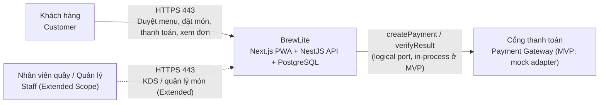
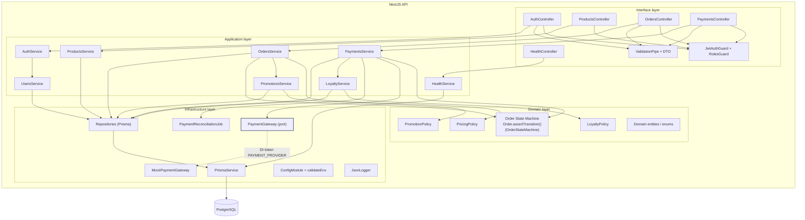

# Kiến trúc hệ thống BrewLite

- **Task**: 3.1 – Phương pháp và quyết định kiến trúc
- **Phiên bản tài liệu**: 1.0
- **Ngày**: 2026-10-19
- **Nguồn yêu cầu**: [`context-and-scope.md`](../requirements/context-and-scope.md), [`srs.md`](../requirements/srs.md), [`use-case-checkout.md`](../requirements/use-case-checkout.md)
- **Nguồn mô hình hóa**: [`activity-checkout.puml`](../diagrams/activity-checkout.puml), [`sequence-checkout.puml`](../diagrams/sequence-checkout.puml), [`class-diagram.puml`](../diagrams/class-diagram.puml)
- **Tài liệu triển khai**: [`deployment.md`](../deployment.md), [`deployment.puml`](../diagrams/deployment.puml)
- **Bộ quyết định kiến trúc**: [`adr/README.md`](./adr/README.md)

> **Trạng thái hiện tại của repository**: Task 1–3 đã hoàn thành phần đặc tả, mô hình hóa, kiến trúc và deployment diagram. CV02–CV06 đã hiện thực khung `apps/api` (NestJS, Prisma schema/migration/seed, `GET /products`) và `apps/web` (Next.js layout, menu, giỏ hàng client). Các phần auth/order/payment, CI/CD và production sẽ tiếp tục ở các task sau. Trạng thái từng thành phần được ghi rõ ở §13.

---

## 1. Mục tiêu, phạm vi và nguyên tắc thiết kế

### 1.1. Mục tiêu nghiệp vụ

BrewLite phục vụ luồng end-to-end:

**Xem menu → Chọn size/topping → Giỏ hàng → Đặt đơn → Thanh toán không tiền mặt → Theo dõi đơn → Nhận tại quầy.**

MVP phải giữ được các tính chất cốt lõi đã đặc tả ở Task 1:

- Giá và tổng tiền do **server** tính lại từ dữ liệu PostgreSQL; client chỉ hiển thị preview (FR-02, FR-03, FR-05).
- Tồn kho được kiểm tra và trừ trong **transaction**; không bán vượt kho (FR-05, NFR-05).
- Thanh toán **idempotent** theo `(userId, orderId, idempotencyKey)` và chặn double-charge kể cả khi client đổi key (FR-06, NFR-05).
- Trạng thái đơn chỉ được chuyển qua **một state machine duy nhất** (FR-08).
- Điểm loyalty được cộng **một lần/đơn**, sau khi transaction thanh toán đã commit (FR-10).
- Không hỗ trợ giao hàng, GPS, tài xế hay tiền mặt trong luồng online (FR-12, FR-13).

### 1.2. Mục tiêu chất lượng

| Mục tiêu | Cách kiến trúc đáp ứng | Truy vết |
| :--- | :--- | :--- |
| Dễ hiểu, dễ nghiệm thu | Một web + một API + một PostgreSQL; backend chia module theo domain, không microservices | ADR-001, ADR-002 |
| Toàn vẹn dữ liệu | Transaction ACID, `SELECT ... FOR UPDATE`, UNIQUE constraint, state machine tập trung | FR-05, FR-06, FR-08, NFR-05 |
| Bảo mật cơ bản | Bcrypt, JWT Guard, RolesGuard, `class-validator`, secret ngoài repository | FR-04, NFR-02, ADR-008 |
| Trải nghiệm mobile-first/PWA | Next.js App Router, manifest, service worker, trạng thái loading/empty/error | FR-01..FR-03, NFR-03, ADR-003, ADR-009 |
| Triển khai được | Docker, GitHub Actions, GHCR, Render (web + API + Postgres) | NFR-04, ADR-006, `deployment.md` |
| Vận hành tối thiểu | JSON log ra stdout, `/health`, `/health/ready`, validate env fail-fast | FR-14, ADR-007 |
| Truy vết | Mã FR/NFR/UC/ADR/Deployment-01 thống nhất từ Task 1 đến Task 5 | §13, `traceability-matrix.md` |

### 1.3. Nguyên tắc thiết kế

1. **Modular monolith trước, microservices sau**: quy mô đồ án không cần nhiều deployable; transaction đơn giản và dễ debug hơn.
2. **Domain là trung tâm**: mỗi module sở hữu nghiệp vụ của mình; controller không gọi Prisma trực tiếp.
3. **Ranh giới rõ cho thanh toán**: `PaymentGateway` là cổng (port), `MockPaymentGateway` là adapter trong process ở MVP; có thể thay bằng gateway thật mà không đổi luồng đơn.
4. **Database là nguồn sự thật**: client không quyết định giá, tổng tiền, trạng thái hay quyền sở hữu đơn.
5. **Idempotency và khóa là mặc định**: mọi thao tác tiền/trạng thái phải có khóa row, unique constraint và đường retry an toàn.
6. **Cấu hình qua môi trường**: không hard-code secret; fail-fast nếu thiếu biến bắt buộc.
7. **Không thêm hạ tầng không cần thiết**: không Kafka, Redis, Kubernetes hay service mesh trong MVP.

### 1.4. Phạm vi kiến trúc

**Trong phạm vi:** frontend PWA, API NestJS, PostgreSQL, migration/seed, mock payment, xác thực, logging, health check, CI/CD và môi trường production.

**Ngoài phạm vi MVP:** KDS/Admin đầy đủ (Extended Scope), giao hàng, tiền mặt, refund thật, webhook gateway thật, đa chi nhánh, microservices, event bus.

---

## 2. C4 – Level 1: System Context



**Giải thích**

- Khách hàng là actor chính của MVP; nhân viên quầy dùng KDS/Admin ở Extended Scope.
- Cổng thanh toán trong MVP là **mock adapter nằm trong NestJS API**, không phải một service mạng độc lập. Trên sơ đồ, nó vẫn được vẽ như một hệ thống ngoài vì đó là ranh giới nghiệp vụ sẽ được thay bằng gateway thật sau này (ADR-005).
- Không có hệ thống giao hàng, GPS hay ứng dụng tài xế (FR-12).

---

## 3. C4 – Level 2: Container

```mermaid
flowchart TB
    Customer["Khách hàng<br/>Customer"]
    Device["User Device<br/>Browser / PWA"]

    subgraph PROD["PRODUCTION"]
        subgraph Render["Render"]
            Web["Render Web Service<br/>Next.js Web (PWA)<br/>Docker image từ GHCR · HTTPS"]
            Api["Render Web Service<br/>NestJS API Container<br/>Docker image từ GHCR · port 3000"]
            Db[("PostgreSQL Database<br/>Render Managed Postgres<br/>persistent storage")]
        end
    end

    subgraph CI["CI / CD"]
        Actions["GitHub Actions<br/>Install → Lint → Test → Build"]
        Registry["GitHub Container Registry<br/>GHCR"]
    end

    Local["Developer Machine<br/>Docker Compose: web + api + db"]

    Customer -->|"HTTPS 443"| Device
    Device -->|"HTTPS 443"| Web
    Device -->|"HTTPS 443<br/>REST/JSON + JWT"| Api
    Web -->|"HTTPS<br/>NEXT_PUBLIC_API_URL"| Api
    Api -->|"PostgreSQL 5432<br/>internal URL + SSL"| Db
    Actions -->|"push image tag SHA/semver"| Registry
    Registry -->|"pull web image"| Web
    Registry -->|"pull api image"| Api
    Actions -->|"deploy hook"| Web
    Actions -->|"deploy hook"| Api
    Local -.->|"git push / pull request"| Actions

    classDef external fill:#fff,stroke:#666,stroke-dasharray: 4 3;
    class Customer,Device external;
```



### 3.1. Bảng container

| Container / nền tảng | Trách nhiệm | Công nghệ | Giao thức / cổng |
| :--- | :--- | :--- | :--- |
| `User Device (Browser/PWA)` | Chạy app shell, service worker, giỏ hàng local; gọi API | Trình duyệt Chrome/Safari | HTTPS 443 |
| `Next.js Web (PWA)` | UI mobile-first, route, cart state, gọi REST API | Next.js App Router, React, TypeScript | HTTPS 443 |
| `Render Web Service (Next.js Web)` | Chạy container web, inject env, TLS, thu log | Render | HTTPS 443 → container 3000 |
| `NestJS API` | REST API, xác thực, nghiệp vụ đơn/thanh toán, health, log | NestJS, TypeScript, Prisma | HTTPS 443 → container 3000 |
| `Render Web Service (NestJS API Container)` | Chạy container API, inject secret/env, restart, thu log | Render | HTTPS 443; container `PORT` |
| `PostgreSQL Database` | Dữ liệu giao dịch, ràng buộc unique/khóa | PostgreSQL | 5432, chỉ nội bộ |
| `Render Managed PostgreSQL` | Managed DB, persistent storage, backup theo gói | Render | Internal URL + SSL |
| `GitHub Actions (CI/CD)` | Quality gate, build image, push registry, deploy, smoke test | GitHub Actions | HTTPS |
| `GitHub Container Registry (GHCR)` | Lưu image web/API theo `sha-<commit>` / semver | GHCR | HTTPS |
| `Developer Machine (Docker Compose)` | Môi trường local 3 service web/api/db | Docker Compose | Cổng local theo `.env` |

### 3.2. Ranh giới tin cậy

| Ranh giới | Bên trong | Bên ngoài | Quy tắc |
| :--- | :--- | :--- | :--- |
| Internet ↔ Render Web | Render Web Service (Next.js) | Trình duyệt | HTTPS, không có secret trong bundle |
| Internet ↔ Render API | Container API | Trình duyệt, Render Web | HTTPS, JWT, CORS theo origin web |
| API ↔ PostgreSQL | Render private network | Internet | Chỉ API truy cập; DB không public; SSL |
| API ↔ Payment Gateway | Mock adapter trong process | Gateway thật tương lai | Chỉ đi qua interface `PaymentGateway` |
| CI ↔ Production | GitHub Actions, GHCR | Render | Deploy bằng secret; không log secret |

---

## 4. C4 – Level 3: Component của NestJS API



### 4.1. Module theo domain

| Module | Trách nhiệm chính | API / thành phần liên quan |
| :--- | :--- | :--- |
| `AuthModule` | Đăng ký, đăng nhập, phát hành JWT, Bcrypt | `POST /auth/register`, `POST /auth/login` (FR-04) |
| `UsersModule` | Truy vấn người dùng, role, điểm loyalty | Dùng bởi Auth/Loyalty (FR-04, FR-10) |
| `ProductsModule` | Menu, chi tiết món, size/topping, tồn kho | `GET /products`, `GET /products/:id` (FR-01, FR-02) |
| `OrdersModule` | Tạo đơn, lịch sử, hủy đơn, state machine | `POST /orders`, `GET /orders/me`, `GET /orders/:id` (FR-05, FR-07, FR-08) |
| `PaymentsModule` | Idempotency, reservation, gọi gateway, đối soát | `POST /payments` (FR-06) |
| `PromotionsModule` | Validate, tính discount, khóa lượt dùng | Dùng trong `POST /orders` (FR-09) |
| `LoyaltyModule` | Cộng/hoàn điểm idempotent theo `orderId` | Sau commit `PENDING → PAID` (FR-10) |
| `HealthModule` | Liveness/readiness | `GET /health`, `GET /health/ready` (FR-14) |
| `PrismaModule` | Kết nối DB, transaction, repository | Toàn API |
| `AuditModule` *(Extended)* | Audit log khi staff đổi sản phẩm | FR-11 |

### 4.2. Quy tắc phụ thuộc

- `Controller → Application Service → Domain Policy/State Machine → Repository → Prisma → PostgreSQL`.
- Controller **không** gọi Prisma trực tiếp; service sở hữu ranh giới transaction.
- Domain không phụ thuộc framework; state machine và policy có thể unit test thuần.
- `PaymentGateway` là port ở infrastructure; application chỉ biết interface, không biết mock hay gateway thật.
- Module chỉ gọi service public của module khác; không import chéo repository.
- Trong một transaction, service mở transaction truyền `tx` (Prisma transaction client) cho repository/service tham gia; không mở transaction lồng nhau. Ví dụ `OrdersService` mở transaction và truyền `tx` cho `PromotionsService` khi validate/áp dụng mã.
- `Order.assertTransition()` (do `OrderStateMachine` hiện thực) là **nguồn duy nhất** của transition (FR-08); `PaymentsService` và `LoyaltyService` không tự định nghĩa transition.

---

## 5. Kiến trúc backend theo lớp

| Lớp | Thành phần | Trách nhiệm | Quy ước vị trí (Task 4–5) |
| :--- | :--- | :--- | :--- |
| Interface | Controller, Guard, Pipe, DTO, Exception Filter | Nhận HTTP, xác thực JWT/role, validate input, trả lỗi thống nhất | `apps/api/src/<domain>/*.controller.ts`, `dto/` |
| Application | `AuthService`, `OrdersService`, `PaymentsService`, ... | Use case, orchestration, transaction boundary, gọi domain policy | `apps/api/src/<domain>/*.service.ts` |
| Domain | `Order.assertTransition()` / `OrderStateMachine`, `PricingPolicy`, `PromotionPolicy`, `LoyaltyPolicy`, entity/enum | Quy tắc nghiệp vụ thuần, không I/O | `apps/api/src/<domain>/domain/` |
| Infrastructure | Repository, `PrismaService`, `PaymentGateway`, `MockPaymentGateway`, `PaymentReconciliationJob`, `JsonLogger`, `ConfigModule` | Truy cập DB, adapter ngoài, cấu hình, log, job | `apps/api/src/<domain>/*.repository.ts`, `prisma/`, `payments/`, `common/` |

### 5.1. Luồng xử lý một request điển hình

1. **Interface**: Guard kiểm tra JWT/role → `ValidationPipe` kiểm tra DTO → controller gọi service.
2. **Application**: service mở transaction (nếu ghi dữ liệu), gọi domain policy/state machine, repository.
3. **Domain**: quyết định transition, giá, discount, điểm; ném lỗi nghiệp vụ có mã rõ ràng.
4. **Infrastructure**: Prisma thực thi SQL trong transaction; adapter thanh toán được gọi sau khi reservation commit.
5. **Interface**: map lỗi nghiệp vụ sang HTTP status; trả response JSON.

### 5.2. Xử lý lỗi và mã HTTP

| Tình huống | HTTP | Ghi chú |
| :--- | :---: | :--- |
| Thiếu/hết hạn JWT | `401` | Guard chặn trước khi vào service |
| Sai role (ví dụ staff-only) | `403` | RolesGuard |
| DTO sai, qty ngoài 1..20, amount lệch, transition sai | `400` | Không gọi gateway/không ghi dữ liệu |
| Không sở hữu đơn | `403` | Kiểm tra `order.userId == jwt.userId` |
| Idempotency key đang `PROCESSING` / còn giao dịch treo | `409` | Không tạo giao dịch mới |
| Gateway lỗi xác định | `400`/`502` | `Payment = FAILED`, `Order = PAYMENT_FAILED` |
| Gateway timeout chưa xác minh | `409`/`202` | Giữ `PROCESSING`, đơn `PENDING`, chờ đối soát |
| Lỗi không mong đợi | `500` | Log kèm correlation id; không lộ stack trace |

Response lỗi thống nhất (ví dụ):

```json
{
  "statusCode": 400,
  "code": "ORDER_INVALID_TRANSITION",
  "message": "Đơn hàng không thể chuyển sang trạng thái này.",
  "details": {}
}
```

---

## 6. Kiến trúc frontend Next.js/PWA

### 6.1. Cấu trúc route dự kiến

| Route | Màn hình | Yêu cầu |
| :--- | :--- | :--- |
| `/` | Menu, tìm kiếm/lọc | FR-01; loading/empty/error |
| `/products/[id]` | Chi tiết món, chọn size/topping, preview giá | FR-02 |
| `/cart` | Giỏ hàng, promo code, tổng tiền preview | FR-03, FR-09 |
| `/login`, `/register` | Xác thực | FR-04 |
| `/checkout` | Xác nhận đơn và thông tin nhận tại quầy (pick-up) | FR-05 |
| `/orders/[id]/payment` | Chọn Ví/Thẻ, xác nhận thanh toán | FR-06 |
| `/orders/[id]/confirmation` | Xác nhận `PAID`, mã đơn | FR-07 |
| `/orders` | Lịch sử và trạng thái đơn | FR-07 |

### 6.2. State và dữ liệu

| Loại state | Công cụ | Quy tắc |
| :--- | :--- | :--- |
| Giỏ hàng | Zustand + `persist` (localStorage) | Chỉ lưu `{productId, size, toppingIds, qty}` và preview; không lưu total có thẩm quyền (FR-03) |
| Auth/JWT | Bộ nhớ + `sessionStorage` (MVP) | Gửi `Authorization: Bearer`; hết hạn `401` → chuyển login, giữ `orderId`/giỏ; không đưa token vào URL/log |
| Server state | `fetch` wrapper trong `lib/api.ts` | Loading/error/empty nhất quán; có thể bổ sung React Query khi cần cache |
| UI state | React state/local | Modal, tab, form; không trộn với cart |

**Công thức preview** (chỉ để hiển thị):

\[
\text{preview} = \sum_{i} \left(\text{basePrice}_i + \text{sizeDelta}_i + \sum_{t} \text{toppingPrice}_{i,t}\right) \times \text{qty}_i
\]

Server **bỏ qua** total client gửi và tính lại từ DB (FR-03, FR-05).

### 6.3. Luồng gọi API và idempotency ở client

- `apiClient` gắn JWT, `Content-Type: application/json`, xử lý `401/403/400/409/5xx` thống nhất.
- `POST /payments` bắt buộc header `Idempotency-Key` là UUID v4 (36 ký tự); thiếu/không hợp lệ → `400` (FR-06).
- Khi bấm "Xác nhận thanh toán": sinh **một** `Idempotency-Key` (UUID v4) cho lần thử hiện tại.
  - Retry do mạng lỗi **cùng một lần thử** → dùng lại key cũ.
  - Sau khi đơn `PAYMENT_FAILED`, khách bấm "Thử thanh toán lại" → sinh key **mới** trên cùng `orderId` (FR-08, EF-4).
  - Đang `PROCESSING`/nhận `409` → không sinh key mới, hiển thị "đang xác minh giao dịch" (EF-5).
- Sau khi `POST /orders` trả `201` với `PENDING`, xóa giỏ ngay; không dùng giỏ cho lần thanh toán lại (FR-05).

### 6.4. PWA và mobile-first

- `manifest.ts`: tên, icon 192/512, theme color, `display: standalone`.
- Service worker: cache app shell và asset same-origin; **không** cache response API có dữ liệu cá nhân; có offline fallback.
- Tăng `CACHE_NAME` mỗi lần đổi app shell để tránh asset cũ.
- Layout mobile-first 360–768px; skeleton/spinner, toast, empty state; kiểm tra Chrome/Safari (NFR-03).

---

## 7. Kiến trúc dữ liệu PostgreSQL

### 7.1. Mô hình dữ liệu

Class diagram Task 2 là nguồn chi tiết. Ở mức kiến trúc, các model/enum chính gồm:

| Nhóm | Model / enum | Ghi chú |
| :--- | :--- | :--- |
| Người dùng | `User`, `UserRole` | `CUSTOMER`, `STAFF`; role đọc từ DB, không tin client |
| Menu | `Product`, `ProductOption`, `ProductStatus`, `OptionType` | `SIZE`, `TOPPING`; tồn kho chỉ ở `Product.stock` |
| Đơn hàng | `Order`, `OrderItem`, `OrderItemOption`, `OrderStatus` | Snapshot tên/giá option tại thời điểm đặt |
| Thanh toán | `Payment`, `PaymentMethod`, `PaymentStatus` | `WALLET`, `CARD`; `Payment` là bản ghi idempotency |
| Khuyến mãi | `Promotion`, `DiscountType`, `PromotionStatus` | Tối đa 1 mã/đơn |
| Loyalty | `LoyaltyTransaction`, `LoyaltyType` | `EARN`, `REVERSAL`; idempotent theo `orderId` |
| Audit *(Extended)* | `AuditLog` | Chỉ FR-11 |

**Không có bảng `Cart`/`CartItem`**: giỏ hàng là state client (FR-03); server không lưu giỏ.

### 7.2. Ràng buộc dữ liệu quan trọng

| Ràng buộc | Mục đích | Truy vết |
| :--- | :--- | :--- |
| `User.email` UNIQUE | Không trùng tài khoản | FR-04 |
| `Order.orderCode` UNIQUE | Mã đơn hiển thị/đối soát | FR-07 |
| `Payment @@unique(userId, orderId, idempotencyKey)` | Chặn retry trùng key, kể cả request đồng thời | FR-06, NFR-05 |
| Index `Payment(orderId, status)` | Tìm giao dịch `PROCESSING` của đơn nhanh | FR-06 |
| `LoyaltyTransaction @@unique(orderId, type)` | Mỗi đơn tối đa 1 `EARN`, 1 `REVERSAL` | FR-10 |
| `Promotion.code` UNIQUE | Mã khuyến mãi không trùng | FR-09 |
| `Product.stock >= 0`, `Payment.amount >= 0`, `Order.totalAmount >= 0` | Chặn dữ liệu âm ở tầng DB | FR-05, FR-06, FR-09 |
| Foreign key + `ON DELETE RESTRICT` cho order/item/payment | Không mất lịch sử giao dịch | FR-07 |

> `PaymentStatus.INITIATED` có trong class diagram nhưng MVP tạo reservation trực tiếp ở `PROCESSING` theo FR-06/Sequence-01. `INITIATED` được giữ cho tương lai (khởi tạo thủ công/đối soát) và không dùng trong happy path.

### 7.3. Ranh giới transaction và khóa

#### Tạo đơn – `POST /orders` (FR-05, FR-09, NFR-05)

```text
BEGIN
  SELECT ... FROM Product WHERE id IN (...) FOR UPDATE
  -- kiểm tra stock, đọc giá base/size/topping từ DB
  IF thiếu hàng → ROLLBACK, 400 kèm danh sách món hết hàng
  IF có promoCode:
      SELECT ... FROM Promotion WHERE code = ? FOR UPDATE
      -- validate hạn dùng, usageLimit global/per-user, minOrder
      IF không hợp lệ → ROLLBACK, 400
  UPDATE Product SET stock = stock - qty
  INSERT Order (PENDING), OrderItem, OrderItemOption (snapshot giá)
  UPDATE Promotion SET usageCount = usageCount + 1 (nếu có mã)
COMMIT
```

- Chọn **pessimistic lock** (`FOR UPDATE`) thay vì optimistic: contention của đồ án thấp nhưng cần chặn oversell/double-charge tuyệt đối; optimistic sẽ phải retry và khó chứng minh trong demo.
- Khóa theo thứ tự cố định (ví dụ sắp `productId`) để giảm deadlock.
- Không dùng `total` client gửi; server tính `subtotal`, `discount = min(configuredDiscount, maxDiscount, subtotal)`, `total = max(0, subtotal - discount)`.
- Lượt dùng **per-user** được đếm từ các `Order` đã gắn cùng `Promotion` của user (quan hệ `Order → Promotion` trong Class-01), không cần thêm bảng ngoài mô hình lớp. Nếu cần chống race tuyệt đối, có thể thêm unique index `(userId, promotionId)` trên `Order` ở migration (index, không thêm entity).

#### Thanh toán – `POST /payments` (FR-06, NFR-05)

```text
-- Bước 0: tra idempotency theo scope (userId, orderId, idempotencyKey)
--   PROCESSING chưa hết expiresAt → 409
--   PAID / FAILED / EXPIRED → trả kết quả đã lưu, KHÔNG gọi gateway lần 2

-- Bước 1: reservation (dưới khóa Order)
BEGIN
  SELECT ... FROM "Order" WHERE id = ? FOR UPDATE
  -- kiểm tra owner, amount == totalAmount, status PENDING/PAYMENT_FAILED
  -- nếu PAYMENT_FAILED: assertTransition(PAYMENT_FAILED → PENDING)
  -- nếu còn Payment khác PROCESSING chưa hết expiresAt → ROLLBACK, 409
  INSERT Payment (PROCESSING, expiresAt)
COMMIT

-- Bước 2: gọi gateway (ngoài transaction)
transactionReference = PaymentGateway.createPayment(orderId, amount, method)

-- Bước 3: chốt kết quả
BEGIN
  UPDATE Payment → PAID + transactionReference
  assertTransition(PENDING → PAID)
  UPDATE Order → PAID
COMMIT

-- Bước 4: sau commit
LoyaltyService.earnPoints(userId, orderId, totalAmount)  -- idempotent theo orderId

-- Nhánh gateway lỗi xác định:
BEGIN
  UPDATE Payment → FAILED
  assertTransition(PENDING → PAYMENT_FAILED)
  UPDATE Order → PAYMENT_FAILED
COMMIT

-- Nhánh timeout chưa xác minh:
--   giữ Payment = PROCESSING (kèm expiresAt), Order = PENDING;
--   PaymentReconciliationJob dùng verifyResult để chốt sau.
```

- UNIQUE `(userId, orderId, idempotencyKey)` là chốt chặn cuối cùng khi hai request cùng key chạy song song; nếu INSERT vi phạm UNIQUE, đọc lại `Payment` theo key và trả `409`/kết quả đã lưu.
- Guard "còn `Payment` khác `PROCESSING` cho cùng `orderId`" nằm dưới khóa `Order FOR UPDATE`, chặn double-charge khi client đổi key.
- Timeout chưa xác minh: **không** kết luận `FAILED`; giữ `PROCESSING`, đơn `PENDING`, job đối soát chốt sau (FR-06, RSK-03).
- Nếu gateway đã thành công nhưng transaction cập nhật DB thất bại: **không** gọi gateway lần 2; giữ `PROCESSING` và đối soát (FR-06).

#### Hủy đơn – `CANCELLED` (FR-08, FR-10)

```text
BEGIN
  SELECT ... FROM "Order" WHERE id = ? FOR UPDATE
  assertTransition(currentStatus → CANCELLED)
  UPDATE Order → CANCELLED
  UPDATE Product SET stock = stock + qty  -- hoàn kho
  IF currentStatus = PAID:
      INSERT LoyaltyTransaction (REVERSAL) + giảm điểm
COMMIT
```

- Chỉ customer hủy `PENDING`/`PAYMENT_FAILED`; staff hỗ trợ `PAID → CANCELLED` (refund ngoài MVP mock).
- Không auto-hủy theo timeout (theo Activity-01).

### 7.4. Migration và seed

- **Công cụ**: Prisma Migrate (SRS quy định Prisma).
- **Local**: `prisma migrate dev` + `prisma db seed`.
- **Production**: `prisma migrate deploy` trước khi start API (entrypoint hoặc pre-deploy command), sau đó seed idempotent (`upsert`) một lần.
- **Forward-only**: không tự động down migration; rollback code bằng image cũ, rollback dữ liệu bằng backup/restore.
- **Một instance migrate**: MVP chạy một API instance để tránh hai container migrate đồng thời; khi scale, chuyển migration sang release job/pre-deploy riêng.
- **Backup**: Render Managed Postgres có backup theo gói; kiểm tra và ghi lại RPO/RTO thực tế trước khi Task 5.4.
- **Seed**: Product mẫu (>= 100 bản ghi để đo NFR-01), size S/M/L, topping, promotion mẫu; không seed secret/tài khoản production ngoài tài khoản demo có mật khẩu được đổi. Seed CV06 hiện có 12 món; khi đo NFR-01 có thể mở rộng lên >= 100 bằng script seed.

### 7.5. Hiệu năng và khả năng mở rộng

- Index tối thiểu: `Product(status)`, `ProductOption(productId)`, `Order(userId, createdAt)`, `Payment(orderId, status)`, `OrderItem(orderId)`.
- API dùng `select`/`include` có kiểm soát, tránh N+1; `GET /products` chỉ trả field cần cho menu.
- Connection pool của Prisma cấu hình theo gói Render; MVP một API instance, scale ngang khi cần (khi đó chuyển migration sang pre-deploy job).
- PWA chỉ cache app shell/asset same-origin; không cache response API cá nhân để tránh dữ liệu cũ.
- Đo NFR-01 bằng seed >= 100 sản phẩm; mục tiêu `GET /products` < 500ms và đặt + thanh toán < 1000ms trong môi trường demo.

---

## 8. Thanh toán mô phỏng và state machine

### 8.1. Ports & adapters

| Thành phần | Vai trò | Ghi chú |
| :--- | :--- | :--- |
| `PaymentGateway` (interface) | Port nghiệp vụ | `createPayment`, `verifyResult(reference?, idempotencyKey)`, `verifyCallback` (Extended) |
| `MockPaymentGateway` | Adapter MVP | Chạy trong process API; cấu hình delay/tỷ lệ lỗi; trả `transactionReference` |
| `PAYMENT_PROVIDER` (DI token) | Chọn adapter | Đổi sang gateway thật không sửa controller/order flow |
| `PaymentReconciliationJob` | Đối soát nền | Xử lý `PROCESSING` quá `expiresAt`; chốt `PAID`/`FAILED`; gọi `markExpired()` khi xác nhận chưa trừ tiền |

- Mock **không** lưu dữ liệu thẻ, không phát sinh tiền thật.
- Gateway thật sau này phải thêm xác thực callback (HMAC, timestamp, replay), secret riêng và không log dữ liệu nhạy cảm.
- `verifyCallback` chỉ là đường Extended; nếu dùng, callback hợp lệ vẫn phải đi qua `assertTransition` của FR-08, không tự định nghĩa transition.
- Nếu timeout xảy ra **trước khi** có `transactionReference`, job đối soát dùng `idempotencyKey` (và `orderId`) để `verifyResult`; không gọi `createPayment` lần hai.

### 8.2. Bảng transition đơn hàng (nguồn: FR-08 / Class-01)

| Từ | Sang | Actor / điều kiện |
| :--- | :--- | :--- |
| `PENDING` | `PAID` | Thanh toán thành công |
| `PENDING` | `PAYMENT_FAILED` | Gateway lỗi **xác định** (timeout chưa xác minh thì giữ `PENDING`) |
| `PAYMENT_FAILED` | `PENDING` | Khách thử thanh toán lại |
| `PENDING` | `CANCELLED` | Customer chủ động hủy |
| `PAYMENT_FAILED` | `CANCELLED` | Customer chủ động hủy |
| `PAID` | `CANCELLED` | Staff hỗ trợ (refund ngoài MVP mock) |
| `PAID` | `PREPARING` | Barista/KDS (Extended) |
| `PREPARING` | `READY` | Barista/KDS (Extended) |
| `READY` | `COMPLETED` | Barista/KDS (Extended) |

`COMPLETED` và `CANCELLED` là terminal. Mọi transition khác trả `400`.

### 8.3. Trạng thái thanh toán

| Trạng thái | Ý nghĩa | Chuyển tiếp |
| :--- | :--- | :--- |
| `PROCESSING` | Reservation đã ghi, đang gọi/chờ gateway | → `PAID`, `FAILED`, `EXPIRED` |
| `PAID` | Gateway xác nhận thành công; lưu `transactionReference` | Terminal |
| `FAILED` | Gateway báo lỗi xác định | Terminal cho lần thử đó; đơn `PAYMENT_FAILED` |
| `EXPIRED` | Quá `expiresAt`, xác nhận chưa trừ tiền | Terminal; đơn vẫn `PENDING` để thử key mới |
| `INITIATED` | Dự phòng, không dùng trong happy path MVP | Không dùng |

### 8.4. Loyalty (FR-10)

- Sau commit `PENDING → PAID`, cộng `floor(totalAmount / 10000)` điểm; ghi `LoyaltyTransaction` type `EARN`, unique theo `(orderId, EARN)`.
- Cập nhật `User.loyaltyPoints` và insert `LoyaltyTransaction` trong cùng transaction, khóa row User hoặc dùng atomic increment để tránh lost update.
- Khi `PAID → CANCELLED`, ghi `REVERSAL` unique theo `(orderId, REVERSAL)` và trừ điểm tương ứng; kiểm tra không để số điểm âm.
- Retry `PAYMENT_FAILED → PAID` không cộng lần hai vì unique `(orderId, type)`; nếu ghi điểm lỗi sau commit, job/retry idempotent xử lý phần còn thiếu.
- MVP không có luồng đổi điểm; quy tắc `discount + điểm` không làm total âm được bảo đảm ở server và ràng buộc `totalAmount >= 0`.

> **Ghi chú nhất quán với Task 1**: RSK-03 mô tả ngắn “timeout → `PAYMENT_FAILED`”, trong khi FR-06 và Sequence-01 quy định rõ timeout **chưa xác minh** phải giữ `Payment = PROCESSING`, đơn `PENDING` và đối soát. Kiến trúc này ưu tiên FR-06/Sequence-01 (đặc tả chi tiết hơn); chỉ chuyển `PAYMENT_FAILED` khi gateway xác nhận thất bại. Cách hiểu RSK-03 là “timeout đã xác minh thất bại”, không phải timeout mất kết nối chưa rõ kết quả.

---

## 9. Xác thực, bảo mật và cấu hình

### 9.1. Xác thực và phân quyền

| Hạng mục | Thiết kế | Truy vết |
| :--- | :--- | :--- |
| Đăng ký | Validate email/mật khẩu ≥ 6; băm Bcrypt salt rounds ≥ 10; email trùng `409` | FR-04, NFR-02 |
| Đăng nhập | So sánh Bcrypt; cấp JWT chứa `userId`, `email`, `role`; expiry ~1h | FR-04 |
| Bảo vệ route | `JwtAuthGuard` cho `POST /orders`, `POST /payments`, `GET /orders/me`; thiếu/hết hạn `401` | FR-04 |
| Phân quyền | `RolesGuard`; role đọc từ DB, không tin client; sai quyền `403` | FR-04, NFR-02 |
| Validate input | Global `ValidationPipe` (`whitelist`, `forbidNonWhitelisted`, `transform`) + DTO `class-validator` | NFR-02 |
| Bí mật | `JWT_SECRET`, `DATABASE_URL`, gateway secret chỉ ở Render/GitHub Secrets; `.env` bị ignore | NFR-02, RSK-04 |
| JWT ở client | Bộ nhớ + `sessionStorage`; không URL/log; CSP; expiry ngắn | ADR-008 |

### 9.2. Bảo mật triển khai

- HTTPS bắt buộc ở cả hai Render Web Service; HSTS/security headers qua Next.js/NestJS (Helmet nếu dùng).
- CORS chỉ cho origin web production và localhost khi dev; không `*` ở production.
- DB production không public; API dùng internal URL + SSL.
- Không log mật khẩu, JWT, `DATABASE_URL`, `Idempotency-Key` đầy đủ hoặc dữ liệu thẻ.
- Rate limit cho `/auth/login` và `/payments` (khuyến nghị; nếu thêm phải ghi trong ADR/README).
- Dependency audit và secret scanning trong CI (GitHub Actions) nếu thời gian cho phép.

### 9.3. Quản lý cấu hình

- `ConfigModule.forRoot({ isGlobal: true, validate })` với `class-validator`; app **fail-fast** nếu thiếu `DATABASE_URL`, `JWT_SECRET`, `PORT`, ...
- Không có default nguy hiểm cho secret ở production.
- `NEXT_PUBLIC_API_URL` được inline lúc build; đổi URL phải rebuild/redeploy web.
- Bảng biến môi trường đầy đủ ở [`deployment.md`](../deployment.md) §5.

---

## 10. Logging, health check và quan sát

| Hạng mục | Thiết kế | Nơi xem |
| :--- | :--- | :--- |
| Structured logging | JSON một dòng/entry: `timestamp`, `level`, `service`, `context`, `message`, `requestId`, `userId?`, `orderId?`; **không** có secret/PII nhạy cảm | stdout container → Render Logs; GitHub Actions; `docker compose logs` |
| Log level | `LOG_LEVEL` (`debug/info/warn/error`) | Render env / local `.env` |
| Liveness | `GET /health` → `200 {status:"ok"}`; không query DB | Render health check / Docker HEALTHCHECK / smoke test NFR-04 |
| Readiness | `GET /health/ready` → `200` khi `SELECT 1` OK; `503` khi DB lỗi | Render health check (khuyến nghị) / CI smoke |
| Correlation | `requestId` sinh ở middleware, trả header `X-Request-Id`, gắn vào log | Log API |
| Metrics/tracing | Không có trong MVP; có thể thêm OpenTelemetry sau | — |
| Alert | Dựa vào health check + log Render; chưa có alerting riêng | — |

> `/health` là endpoint **bắt buộc** theo FR-14/NFR-04. `/health/ready` là bổ sung vận hành, không thay thế `/health` trong smoke test.

---

## 11. Kiến trúc triển khai (tóm tắt)

Chi tiết và runbook ở [`deployment.md`](../deployment.md); sơ đồ UML ở [`deployment.puml`](../diagrams/deployment.puml) + [`deployment.svg`](../diagrams/deployment.svg).

| Môi trường | Thành phần | Mục đích |
| :--- | :--- | :--- |
| **Local** | Docker Compose: `web`, `api`, `db` | Phát triển, test tích hợp, demo offline |
| **CI** | GitHub Actions runner | Install → Lint → Unit Test → Build; build/push image; smoke test |
| **Production** | Render Web Service (Next.js) + Render Web Service (API) + Render Managed Postgres + GHCR | Người dùng truy cập qua HTTPS |

**Quyết định nền tảng**: Render + GHCR (ADR-006). Lý do: cả web và API đều chạy Docker (đúng ràng buộc Task 1), Render có managed Postgres/HTTPS/log, GHCR tách build khỏi runtime và cho phép rollback theo image tag.

---

## 12. Lý do chọn kiến trúc, ưu điểm và trade-off

### 12.1. Vì sao modular monolith

- Quy mô đồ án nhỏ, một nhóm, một database; transaction ACID trong một DB đơn giản hơn saga/distributed transaction.
- Một pipeline, một container API, một lịch sử commit; dễ review và truy vết FR → module → test.
- Ranh giới domain rõ để có thể tách service sau này nếu tải thật sự tăng.

### 12.2. Ưu điểm

- Ít thành phần vận hành; chi phí và độ phức tạp thấp.
- Dễ đảm bảo nhất quán dữ liệu cho đơn/thanh toán/tồn kho.
- Frontend và backend tách biệt qua REST/JSON, có thể deploy độc lập.
- Payment adapter che giấu mock/gateway thật; dễ test success/failure/timeout.
- Docker + GHCR + Render cho phép CI/CD và rollback theo image/deployment.

### 12.3. Hạn chế và trade-off

| Trade-off | Hệ quả | Giảm thiểu |
| :--- | :--- | :--- |
| Một API là single point of failure | API lỗi → toàn bộ đặt món/thanh toán dừng | Health check, restart, rollback image; chấp nhận với đồ án |
| Không scale độc lập domain | Payment/order dùng chung tài nguyên | Scale ngang cả API; tách module khi có nhu cầu |
| Migration lúc start container | Nhiều instance có thể migrate đồng thời | MVP 1 instance; pre-deploy job khi scale |
| Phụ thuộc Render/GHCR | Vendor lock-in, cold start, giới hạn gói/CDN | Docker image portable; CI build độc lập; kiểm tra gói chính thức |
| Mock payment không đại diện gateway thật | Thiếu webhook/chữ ký/đối soát thật | Port/adapter + `verifyResult`/`verifyCallback` dự phòng |
| JWT ở client | Rủi ro XSS nếu lưu lâu | `sessionStorage`, expiry ngắn, CSP, không log token |
| PWA cache thủ công | Có thể serve asset cũ | Tăng `CACHE_NAME`, test sau deploy |
| Log tự viết | Thiếu sampling/tracing | Đủ cho đồ án; nâng lên Pino/OTel khi cần |

### 12.4. Các phương án đã cân nhắc

| Phương án | Ưu điểm | Nhược điểm | Kết luận |
| :--- | :--- | :--- | :--- |
| Microservices (auth/order/payment riêng) | Scale độc lập | Nhiều deployable, network failure, distributed transaction, vận hành phức tạp | **Không chọn** |
| Một codebase không chia module | Nhanh lúc đầu | Khó trace, khó test, dễ coupling | **Không chọn** |
| Tách mock payment thành service riêng | Ranh giới mạng rõ | Không cần thiết, mất transaction đơn giản, thêm chi phí | **Không chọn** |
| VPS tự quản lý (Docker + Nginx + Certbot) | Kiểm soát toàn bộ | Tốn thời gian vận hành, TLS/backup/monitoring tự làm | **Không chọn** |
| Render (web + API + Postgres) + GHCR | Một nhà cung cấp, cả web/API chạy Docker, có HTTPS/managed DB | CDN/cache của Render có thể kém hơn Vercel; phụ thuộc Render | **Chọn** (ADR-006) |

---

## 13. Truy vết kiến trúc

### 13.1. Yêu cầu → thành phần kiến trúc

| Mã | Thành phần kiến trúc chính | ADR / sơ đồ | Ghi chú |
| :--- | :--- | :--- | :--- |
| FR-01 | Next.js menu, `ProductsModule`, `Product` | ADR-003, ADR-004, Deployment-01 | Loading/empty/error; index/select tối ưu |
| FR-02 | `ProductsModule`, `ProductOption`, `PricingPolicy`, route chi tiết | ADR-002, ADR-004 | Size/Topping là price modifier, không có kho riêng |
| FR-03 | Zustand cart + persist, `apiClient` | ADR-009 | Không có bảng Cart; server bỏ qua total client |
| FR-04 | `AuthModule`, `UsersModule`, JWT/Bcrypt | ADR-008 | Role từ DB; guard/role |
| FR-05 | `OrdersModule`, transaction + `SELECT FOR UPDATE` | ADR-002, ADR-004 | Trừ kho, snapshot giá, `PENDING` |
| FR-06 | `PaymentsModule`, `PaymentGateway`, `PaymentReconciliationJob`, unique key | ADR-005, ADR-006, Deployment-01 | Reservation trước gateway; idempotent |
| FR-07 | `OrdersModule`, `GET /orders/me`, Next.js history | ADR-003 | Lọc theo `jwt.userId` |
| FR-08 | `Order.assertTransition()` (do `OrderStateMachine` hiện thực) | ADR-002, Class-01 | Nguồn duy nhất của transition |
| FR-09 | `PromotionsModule`, `PromotionPolicy`, khóa row | ADR-004 | 1 mã/đơn, trần discount |
| FR-10 | `LoyaltyModule`, `LoyaltyTransaction`, sau commit | ADR-002, ADR-004 | Idempotent theo `orderId` |
| FR-11 | `AuditModule` (Extended), `RolesGuard` | ADR-008 | Ngoài MVP |
| FR-14 | `HealthModule`, `/health`, seed/migration | ADR-007, Deployment-01 | Smoke test |
| NFR-01 | Index DB, select fields, PWA cache, 1 API instance | ADR-004, ADR-006 | Đo ở Task 5.2 |
| NFR-02 | Bcrypt, JWT Guard, RolesGuard, ValidationPipe, secret | ADR-008, ADR-007 | `.env` ignored |
| NFR-03 | Next.js mobile-first, manifest, service worker | ADR-003, ADR-009 | Chrome/Safari 360–768px |
| NFR-04 | Docker, GitHub Actions, GHCR, Render (web + API + Postgres), health, rollback | ADR-001, ADR-006, Deployment-01 | Pipeline Task 4.4/5.3 |
| NFR-05 | Transaction, `FOR UPDATE`, UNIQUE, state machine | ADR-004, ADR-005 | Khóa + idempotency |

### 13.2. Thành phần → vị trí mã nguồn dự kiến

| Thành phần | Vị trí dự kiến (Task 4–5) |
| :--- | :--- |
| Next.js app, manifest, service worker | `apps/web/app/`, `apps/web/public/` |
| API bootstrap, module wiring | `apps/api/src/main.ts`, `apps/api/src/app.module.ts` |
| Domain modules | `apps/api/src/{auth,users,products,orders,payments,promotions,loyalty,health}/` |
| Prisma schema/migration/seed | `apps/api/prisma/` |
| Payment port/adapter | `apps/api/src/payments/payment-gateway.interface.ts`, `mock-payment.gateway.ts` |
| State machine/policies | `apps/api/src/orders/domain/`, `apps/api/src/promotions/domain/`, `apps/api/src/loyalty/domain/` |
| Logging/config | `apps/api/src/common/logging/`, `apps/api/src/config/` |
| Docker/Compose | `apps/api/Dockerfile`, `apps/web/Dockerfile`, `docker-compose.yml` |
| CI/CD | `.github/workflows/ci.yml`, `.github/workflows/cd.yml` |

### 13.3. Trạng thái tạo tác

| Tạo tác | Trạng thái | Ghi chú |
| :--- | :--- | :--- |
| Task 1: context, SRS, use-case | **Đã có** | `docs/requirements/` |
| Task 2: Activity/Sequence/Class | **Đã có** | `docs/diagrams/*.puml` + SVG |
| Task 3.1: kiến trúc + ADR | **Đã có trong tài liệu này** | Task 3.1 |
| Task 3.2: deployment diagram + deployment.md | **Đã có** | `docs/diagrams/deployment.puml`, `docs/deployment.md` |
| Source web/api | **Đã có khung CV02–CV06** | `apps/web`, `apps/api`; menu, schema, migration, seed |
| CI/CD, Dockerfile API/Web, production URL | **Kế hoạch Task 4–5** | Docker Compose PostgreSQL local đã có; CI/CD và production sẽ bổ sung |

---

## 14. Rủi ro kiến trúc và việc cần làm

| Mã | Rủi ro | Ảnh hưởng | Giảm thiểu / việc cần làm |
| :--- | :--- | :--- | :--- |
| AR-01 | Hai request thanh toán cùng key/khác key | Trừ tiền 2 lần | Unique key + `Order FOR UPDATE` + guard `PROCESSING` (FR-06) |
| AR-02 | Hai khách mua món cuối cùng | Oversell | `Product FOR UPDATE` + transaction + kiểm tra stock (NFR-05) |
| AR-03 | Timeout gateway chưa xác minh | Đơn treo, khách bấm lại | Giữ `PROCESSING`, job đối soát, `expiresAt` (FR-06) |
| AR-04 | Migration chạy đồng thời | Schema lỗi | 1 instance / pre-deploy job (ADR-004) |
| AR-05 | Secret lộ qua log/repo | Mất an toàn | `.gitignore`, secret dashboard, redaction (NFR-02) |
| AR-06 | PWA cache asset cũ | UI lỗi sau deploy | Version cache, test sau deploy (ADR-003) |
| AR-07 | Cold start Render gói thấp | Chậm lần đầu | Health check, giữ instance ấm nếu gói cho phép; ghi nhận trade-off |
| AR-08 | Production chưa deploy | Task 5 không đạt | Checklist `deployment.md` §9; làm ở Task 5.3–5.4 |

---

## 15. Bộ quyết định kiến trúc (ADR)

| ADR | Quyết định |
| :--- | :--- |
| [ADR-001](./adr/001-monorepo.md) | Monorepo pnpm workspaces |
| [ADR-002](./adr/002-modular-monolith-nestjs.md) | Modular monolith NestJS theo domain |
| [ADR-003](./adr/003-nextjs-pwa.md) | Next.js App Router + PWA mức cơ bản |
| [ADR-004](./adr/004-postgresql-prisma-migration.md) | PostgreSQL + Prisma Migrate |
| [ADR-005](./adr/005-mock-payment-adapter.md) | PaymentGateway port + MockPaymentGateway adapter |
| [ADR-006](./adr/006-deployment-platform.md) | Render cho web/API/Postgres + GHCR |
| [ADR-007](./adr/007-logging-health-config.md) | JSON logging, health check, validate config |
| [ADR-008](./adr/008-auth-jwt-bcrypt.md) | JWT + Bcrypt + Guard/Role |
| [ADR-009](./adr/009-frontend-state.md) | Zustand cho cart + fetch wrapper |

---

## 16. Tài liệu liên quan

- [`../requirements/srs.md`](../requirements/srs.md) – FR/NFR và tiêu chí chấp nhận.
- [`../requirements/context-and-scope.md`](../requirements/context-and-scope.md) – stakeholder, phạm vi, rủi ro.
- [`../requirements/use-case-checkout.md`](../requirements/use-case-checkout.md) – UC-08 và các luồng thanh toán.
- [`../diagrams/activity-checkout.puml`](../diagrams/activity-checkout.puml) – Activity-01.
- [`../diagrams/sequence-checkout.puml`](../diagrams/sequence-checkout.puml) – Sequence-01.
- [`../diagrams/class-diagram.puml`](../diagrams/class-diagram.puml) – Class-01.
- [`../diagrams/deployment.puml`](../diagrams/deployment.puml) – Deployment-01.
- [`../deployment.md`](../deployment.md) – hướng dẫn triển khai, secret, rollback.
- [`../traceability-matrix.md`](../traceability-matrix.md) – ma trận truy vết tổng.
