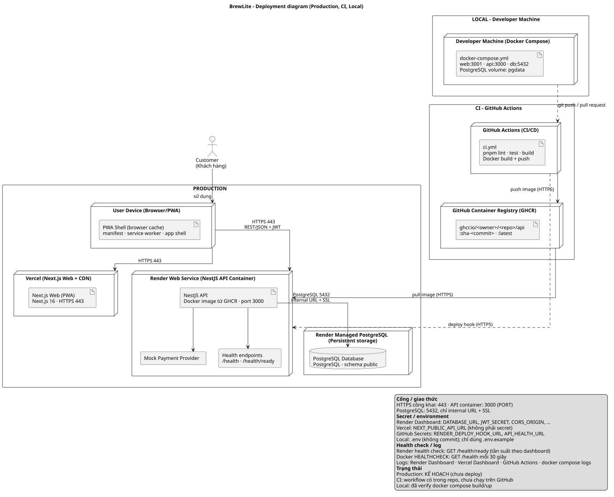

# Deployment – BrewLite

- **Task**: 3.2 – Deployment diagram
- **Nguồn sơ đồ**: [`diagrams/deployment.puml`](./diagrams/deployment.puml)
- **Bản kết xuất**: [`diagrams/deployment.svg`](./diagrams/deployment.svg)
- **Cập nhật**: 2026-10-19
- **Trạng thái chung**: hạ tầng production **chưa deploy**; các node production dưới đây là **kế hoạch**.




## 1. Trạng thái từng node

| Node | Trạng thái | Bằng chứng / ghi chú |
| :--- | :--- | :--- |
| `User Device (Browser/PWA)` | Kế hoạch | Có manifest + service worker; chưa có URL production |
| `Vercel (Next.js Web + CDN)` | **Kế hoạch** | Chưa tạo project Vercel; `apps/web` build được ở local |
| `Next.js Web (PWA)` | Đã build (local + Docker) | `apps/web`; `pnpm --filter @brewlite/web build` và Docker image đều thành công |
| `Render Web Service (NestJS API Container)` | **Kế hoạch** | Chưa tạo service; Dockerfile build được ở local |
| `NestJS API` | Đã build container; skeleton nghiệp vụ | `/health`, `/health/ready`; domain modules TODO Sprint 2 |
| `Mock Payment Provider` | Khung | Interface + mock provider; chưa nối vào `POST /payments` |
| `Health endpoints` | Đã có | `/health` = 200; `/health/ready` = 503 khi DB lỗi, = 200 khi DB sẵn sàng (đã kiểm tra local + Docker) |
| `Render Managed PostgreSQL` | **Kế hoạch** | Chưa tạo DB trên Render |
| `PostgreSQL Database` | Đã có schema/migration | Migration `20261019000000_init` đã apply thành công trong Docker Compose local |
| `GitHub Actions (CI/CD)` | Workflow có, chưa chạy | `.github/workflows/ci.yml`; repo local chưa đẩy lên GitHub |
| `GitHub Container Registry (GHCR)` | **Kế hoạch** | Chưa có package/image |
| `Developer Machine (Docker Compose)` | **Đã verify** | `docker compose build` + `up` chạy 3 service; DB healthy, migration apply, API/web trả 200 |

**Đã verify ở local (không phải production)**

- `pnpm --filter @brewlite/api lint` – pass.
- `pnpm --filter @brewlite/api test` – 3 suite, 6 test pass.
- `pnpm --filter @brewlite/api build` – pass.
- `pnpm --filter @brewlite/web lint` – pass.
- `pnpm --filter @brewlite/web build` – pass (Next.js 16.4.2).
- API chạy với DB không tồn tại: `GET /health` → `200`, `GET /health/ready` → `503`.
- `docker compose build` – build thành công cả image `brewlite-api` và `brewlite-web`.
- `docker compose up -d` – PostgreSQL healthy; migration init apply; `GET /health` → `200`; `GET /health/ready` → `200`; web `GET /` → `200`; manifest → `200`.

## 2. Giải thích từng node

| Node | Vai trò | Giao thức / cổng |
| :--- | :--- | :--- |
| `Customer` | Khách hàng dùng trình duyệt/PWA | HTTPS |
| `User Device (Browser/PWA)` | Thiết bị chạy app shell, service worker, giỏ hàng local | HTTPS 443 tới Vercel/Render |
| `Vercel (Next.js Web + CDN)` | CDN + hosting Next.js, TLS, deploy từ Git | HTTPS 443 |
| `Next.js Web (PWA)` | Container web (Next.js App Router); gọi API qua `NEXT_PUBLIC_API_URL` | HTTPS 443 |
| `Render Web Service (NestJS API Container)` | Chạy image Docker API, inject env, restart, thu log | HTTPS 443; container `PORT=3000` |
| `NestJS API` | REST API, health, log JSON, nghiệp vụ | HTTP nội bộ container 3000 |
| `Mock Payment Provider` | Adapter thanh toán mô phỏng trong process API | Không mở cổng mạng |
| `Health endpoints` | `/health` (liveness), `/health/ready` (DB) | HTTP qua API |
| `Render Managed PostgreSQL` | DB managed, persistent storage, backup theo gói | PostgreSQL 5432, internal URL + SSL |
| `PostgreSQL Database` | Schema `public`, bảng/enum theo Prisma | Chỉ API truy cập |
| `GitHub Actions (CI/CD)` | Lint/test/build, build & push image, deploy hook, smoke test | HTTPS tới GitHub/GHCR/Render |
| `GitHub Container Registry (GHCR)` | Lưu image `ghcr.io/<owner>/<repo>/api:sha-<commit>` và `:latest` | HTTPS |
| `Developer Machine (Docker Compose)` | Local web/api/db, volume `pgdata` | web 3001 → 3000; api 3000; db 5432 |

## 3. Biến môi trường

Các file `.env.example` chỉ chứa placeholder/local default.

### 3.1 API (Render Web Service)

| Biến | Ý nghĩa | Nơi cấu hình | Secret? |
| :--- | :--- | :--- | :---: |
| `NODE_ENV` | `production` trên Render | Render Environment | Không |
| `PORT` | Cổng container API, mặc định `3000` | Render Environment / Dockerfile | Không |
| `LOG_LEVEL` | Mức log (`debug/info/warn/error`) | Render Environment | Không |
| `DATABASE_URL` | PostgreSQL connection string | Render Environment (Internal URL) | **Có** |
| `CORS_ORIGIN` | Origin web được phép gọi API | Render Environment | Không |
| `JWT_SECRET` | Khóa ký JWT, tối thiểu 32 ký tự | Render Secret | **Có** |
| `JWT_EXPIRES_IN` | Thời hạn token, dự kiến `1h` | Render Environment | Không |
| `PAYMENT_PROVIDER` | Hiện chỉ hỗ trợ `mock` | Render Environment | Không |
| `PAYMENT_MOCK_DELAY_MS` | Độ trễ giả lập | Render Environment | Không |
| `PAYMENT_MOCK_FAILURE_RATE` | Tỷ lệ lỗi giả lập 0..1 | Render Environment | Không |
| `RUN_MIGRATIONS` | `true` để chạy `prisma migrate deploy` khi container start | Render Environment | Không |

Nguồn: `apps/api/.env.example`, `apps/api/src/config/env.validation.ts`, `apps/api/docker-entrypoint.sh`.

### 3.2 Web (Vercel)

| Biến | Ý nghĩa | Nơi cấu hình | Secret? |
| :--- | :--- | :--- | :---: |
| `NEXT_PUBLIC_API_URL` | URL công khai của API (inline lúc build) | Vercel Project → Environment Variables | Không |
| `NEXT_TELEMETRY_DISABLED` | Tắt telemetry Next.js | Vercel Environment | Không |

Nguồn: `apps/web/.env.example`, `apps/web/app/page.tsx`.

### 3.3 Local (Docker Compose)

| Biến | Ý nghĩa | Nơi cấu hình | Secret? |
| :--- | :--- | :--- | :---: |
| `POSTGRES_USER` | User PostgreSQL local | `.env` (copy từ `.env.example`) | Không |
| `POSTGRES_PASSWORD` | Mật khẩu PostgreSQL local | `.env` | Local-only |
| `POSTGRES_DB` | Tên database | `.env` | Không |
| `POSTGRES_PORT` | Cổng publish DB local | `.env` | Không |
| `API_PORT` | Cổng publish API local | `.env` | Không |
| `WEB_PORT` | Cổng publish web local | `.env` | Không |
| `JWT_SECRET` | Secret JWT local (fallback compose) | `.env` | Local-only |

Nguồn: `.env.example`, `docker-compose.yml`.

### 3.4 CI (GitHub Actions)

| Biến / secret | Ý nghĩa | Nơi cấu hình | Secret? |
| :--- | :--- | :--- | :---: |
| `GITHUB_TOKEN` | Push image lên GHCR (`packages:write`) | GitHub Actions tự cấp | **Có** (ephemeral) |
| `RENDER_DEPLOY_HOOK_URL` | Trigger Render redeploy sau khi push image | GitHub Repository Secret | **Có** |
| `API_HEALTH_URL` | Base URL API để smoke test `/health/ready` | GitHub Repository Secret | Không (khuyến nghị để Secret/Variable) |

Nguồn: `.github/workflows/ci.yml`.

## 4. Luồng deploy

```text
Developer push/PR
  → GitHub Actions: install → prisma generate → lint → test → build
  → Docker build apps/api/Dockerfile
  → Push GHCR: sha-<commit>, branch, semver, latest
  → (main) gọi RENDER_DEPLOY_HOOK_URL
  → Render pull image mới
  → docker-entrypoint.sh: prisma migrate deploy
  → node apps/api/dist/main.js
  → CI smoke test: GET <API_HEALTH_URL>/health/ready
  → Vercel tự deploy Next.js từ nhánh main (Git integration)
```

Chi tiết từng bước:

1. **Quality gate**: PR fail lint/test/build thì không merge (cần bật branch protection trên GitHub).
2. **Image**: tag `sha-<commit>` để truy vết; `latest` cho Render pull.
3. **Registry**: GHCR. Nếu package private, Render cần registry credential; nếu public, Render pull trực tiếp. Cấu hình này **cần kiểm tra lại trong dashboard Render**.
4. **Deploy**: Render Web Service dùng image từ GHCR. Deploy hook chỉ hoạt động khi service đã được cấu hình; nếu Render không tự pull `latest`, cần cập nhật image tag/digest trong dashboard hoặc dùng Render API.
5. **Migration**: entrypoint chạy `prisma migrate deploy` trước khi start. MVP giả định **một instance**; xem `architecture.md` §5.
6. **Smoke test**: CI gọi `/health/ready` tối đa 20 lần, cách 15 giây. Nếu chưa đặt `API_HEALTH_URL`, bước này skip (không fail).
7. **Web**: Vercel deploy từ Git; `NEXT_PUBLIC_API_URL` phải trỏ tới API production **trước khi build**.

**Rollback**

- API: Render redeploy image tag/digest cũ (ví dụ `sha-<commit>` trước); không rollback migration tự động.
- Web: Vercel → Deployments → chọn deployment cũ → Promote.
- DB: migration forward-only; nếu migration lỗi, restore backup theo gói Render rồi deploy lại image cũ. **Cần kiểm tra quy trình backup/restore thực tế trên Render**.

## 5. Việc còn thiếu để khớp sơ đồ

| # | Việc cần làm tay | Nơi thực hiện | Trạng thái |
| :---: | :--- | :--- | :--- |
| 1 | Tạo GitHub repo, push code, bật branch protection cho `main` | GitHub | Chưa |
| 2 | Tạo Render Managed PostgreSQL; lấy Internal Database URL | Render Dashboard | Chưa |
| 3 | Tạo Render Web Service từ image GHCR; đặt env/secret; health check `/health/ready` | Render Dashboard | Chưa |
| 4 | Tạo GHCR package; quyết định public/private + credential cho Render | GHCR / Render | Chưa |
| 5 | Đặt `RENDER_DEPLOY_HOOK_URL`, `API_HEALTH_URL` | GitHub → Settings → Secrets | Chưa |
| 6 | Tạo Vercel project; đặt `NEXT_PUBLIC_API_URL`; deploy | Vercel Dashboard | Chưa |
| 7 | Chạy migration lần đầu và seed dữ liệu mẫu (seed TODO) | Render shell/job | Chưa |
| 8 | Kiểm tra `/health`, `/health/ready`, log JSON, CORS | Production URL | Chưa |
| 9 | Kiểm tra lại giới hạn gói free, backup, health check interval, cách Render pull image | Trang giá/tài liệu chính thức | Chưa |

## 6. Ranh giới ba môi trường

| Môi trường | Thành phần | Cấu hình | Dữ liệu |
| :--- | :--- | :--- | :--- |
| **Local** | Docker Compose: web 3001, api 3000, db 5432 | `.env` + `.env.example`; volume `pgdata` | Dữ liệu dev, có thể xóa |
| **CI** | GitHub Actions runner | `GITHUB_TOKEN`, GitHub Secrets; không cần DB thật cho lint/test/build hiện tại | Không có dữ liệu production |
| **Production** | Vercel + Render API + Render Postgres + GHCR | Render/Vercel env dashboard; GitHub Secrets | Dữ liệu thật, backup theo gói |

## 7. Quan sát, secret và log

- **Secret**: chỉ đặt ở Render Environment/Secret, Vercel Environment, GitHub Secrets. `.env` bị ignore; chỉ commit `.env.example` với placeholder.
- **Log API**: JSON một dòng/entry ra stdout (`JsonLogger`), Render thu và hiển thị ở **Render Dashboard → Logs**. Không log mật khẩu/token/`DATABASE_URL`.
- **Log web**: Vercel Dashboard → Deployments/Runtime Logs.
- **Log CI**: GitHub Actions run logs; không echo secret.
- **Health check**: Render dùng `/health` và `/health/ready`. Docker gọi `/health` mỗi 30 giây.

## 8. Các file hỗ trợ triển khai

| File | Mục đích | Trạng thái |
| :--- | :--- | :--- |
| `apps/api/Dockerfile` | Multi-stage, chạy non-root, healthcheck | Đã build thành công bằng Docker |
| `apps/api/docker-entrypoint.sh` | Chạy migration rồi start API | Đã chạy migration thành công trong compose |
| `apps/api/src/health/` | `/health`, `/health/ready` | Đã có, đã chạy thử local + Docker |
| `apps/api/src/config/env.validation.ts` | Validate env khi khởi động | Đã có |
| `apps/api/src/common/logging/json-logger.ts` | Log JSON ra stdout | Đã có |
| `apps/api/.env.example` | Mẫu env API, không chứa secret thật | Đã có |
| `apps/web/.env.example` | Mẫu env web | Đã có |
| `apps/web/Dockerfile` | Next.js standalone, non-root | Đã build thành công bằng Docker |
| `docker-compose.yml` | Local web + API + PostgreSQL | Đã chạy 3 service thành công |
| `.github/workflows/ci.yml` | Lint/test/build, GHCR, deploy hook, smoke test | Đã có; chưa chạy trên GitHub |
| `pnpm-workspace.yaml`, `package.json`, `pnpm-lock.yaml` | Monorepo pnpm | Đã có |
| `.env.example` (root) | Biến local cho compose | Đã có, chỉ giá trị local |

