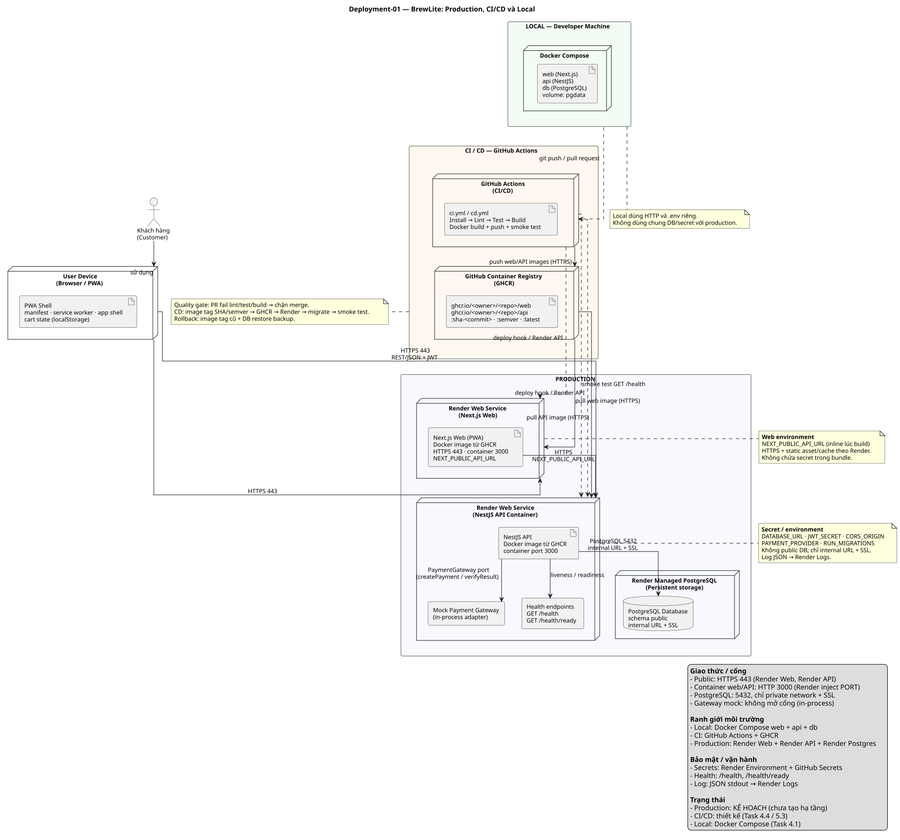

# Triển khai BrewLite – Môi trường production, CI/CD và vận hành

- **Task**: 3.2 – Deployment diagram + tài liệu triển khai
- **Phiên bản**: 1.0
- **Ngày**: 2026-10-19
- **Nguồn sơ đồ**: [`diagrams/deployment.puml`](./diagrams/deployment.puml)
- **Bản kết xuất**: [`diagrams/deployment.svg`](./diagrams/deployment.svg)
- **Kiến trúc tham chiếu**: [`architecture/architecture.md`](./architecture/architecture.md)
- **Quyết định nền tảng**: [`ADR-006`](./architecture/adr/006-deployment-platform.md)

> **Trạng thái hạ tầng**: production **chưa được tạo**. Các node Render/GHCR dưới đây là **kế hoạch triển khai** đã chốt về mặt kiến trúc; Task 5.3–5.4 sẽ tạo hạ tầng thật, chạy pipeline và cập nhật URL/trạng thái vào tài liệu này. Không có URL production giả được ghi vào repository.



---

## 1. Mục tiêu triển khai

Thiết kế phải đáp ứng NFR-04:

- Frontend và API chạy trên HTTPS, truy cập được từ Internet.
- PostgreSQL production **không public**, có persistent storage.
- CI chạy `Install → Lint → Unit Test → Build`; PR fail thì không merge.
- CD build image tag `commit SHA`/semver → push registry → deploy bằng secret → migration an toàn → smoke test `GET /health`.
- Có đường rollback rõ ràng khi deploy lỗi.
- Secret không xuất hiện trong repository hoặc log CI.
- Có health check và log để vận hành.

---

## 2. Sơ đồ tổng quát môi trường

```text
┌──────────────────────────── PRODUCTION ────────────────────────────┐
│                                                                    │
│  Khách hàng (Browser/PWA)                                          │
│        │ HTTPS 443                                                 │
│        ├──────────────► Render Web Service (Next.js Web)           │
│        │                       │ HTTPS + NEXT_PUBLIC_API_URL       │
│        │                       ▼                                    │
│        └──────────────► Render Web Service (NestJS API container)   │
│                                 │ internal PostgreSQL 5432 + SSL    │
│                                 ▼                                    │
│                        Render Managed PostgreSQL (persistent)       │
│                                                                    │
└────────────────────────────────────────────────────────────────────┘

┌────────────────────── CI/CD – GitHub Actions ──────────────────────┐
│  PR: install → lint → unit test → build                            │
│  main/tag: build web/API images → push GHCR → deploy Render        │
│            → migrate → smoke test                                  │
└────────────────────────────────────────────────────────────────────┘

┌──────────────────── LOCAL – Developer Machine ─────────────────────┐
│  Docker Compose: web + api + db (volume pgdata)                    │
└────────────────────────────────────────────────────────────────────┘
```

---

## 3. Thành phần production và trách nhiệm

| Node | Nền tảng | Trách nhiệm | Giao thức / cổng | Persistent? |
| :--- | :--- | :--- | :--- | :---: |
| `User Device (Browser/PWA)` | Thiết bị khách hàng | Chạy app shell, service worker, cart local | HTTPS 443 | Không |
| `Render Web Service (Next.js Web)` | Render | Chạy container Next.js, TLS, static asset/cache theo hạ tầng Render, rollback theo image | HTTPS 443 → container 3000 | Không |
| `Next.js Web (PWA)` | Render | UI mobile-first, route, gọi API | HTTPS 443 | Không |
| `Render Web Service (NestJS API Container)` | Render | Chạy container API, inject env/secret, restart, thu log | HTTPS 443 → container `PORT` | Không |
| `NestJS API` | Docker image từ GHCR | REST API, auth, order/payment, health, log | HTTP nội bộ container 3000 | Không |
| `Mock Payment Gateway` | Trong process API | Mô phỏng thành công/thất bại/timeout | Không mở cổng | Không |
| `Health endpoints` | NestJS | `/health` (liveness), `/health/ready` (readiness) | HTTP qua API | Không |
| `Render Managed PostgreSQL` | Render | Lưu dữ liệu, backup theo gói | 5432, internal URL + SSL | **Có** |
| `GitHub Actions (CI/CD)` | GitHub | Quality gate, build, push, deploy, smoke test | HTTPS | Không |
| `GitHub Container Registry (GHCR)` | GitHub | Lưu image `sha-<commit>`, semver, `latest` | HTTPS | **Có** |
| `Developer Machine (Docker Compose)` | Local | web + api + db, volume `pgdata` | Cổng local theo `.env` | **Có** (local) |

### 3.1. Vì sao chọn Render + GHCR

- Một nhà cung cấp cho cả web/API/Postgres; ít biến môi trường và ít luồng deploy.
- Cả Next.js và NestJS đều chạy Docker, đúng ràng buộc “container hóa production” của Task 1; Dockerfile dùng lại được ở local/CI.
- Local/CI dùng Docker Compose; production dùng cùng Docker image trên Render (nền tảng managed không chạy Compose). Cách này giữ nguyên nguyên tắc container hóa nhưng tận dụng managed service.
- Render có HTTPS, managed PostgreSQL, private networking, health check và log tập trung.
- GHCR tách build khỏi runtime; image tag theo commit giúp truy vết và rollback.
- Không cần tự quản trị VPS/Nginx/Certbot; phù hợp thời gian đồ án.
- Chi tiết trade-off: ADR-006 và `architecture.md` §12.

---

## 4. Ranh giới local – CI – production

| Môi trường | Thành phần | Cấu hình | Dữ liệu | Ai truy cập |
| :--- | :--- | :--- | :--- | :--- |
| **Local** | Docker Compose: `web`, `api`, `db` | `.env` local (copy từ `.env.example`); volume `pgdata` | Dữ liệu dev, có thể xóa | Nhóm phát triển |
| **CI** | GitHub Actions runner | GitHub Secrets; không cần DB thật nếu test dùng test container/mock | Không có dữ liệu production | GitHub Actions |
| **Production** | Render Web (Next.js) + Render API + Render Postgres + GHCR | Render env dashboard; GitHub Secrets | Dữ liệu thật, backup theo gói | Người dùng qua HTTPS; nhóm qua dashboard |

**Quy tắc tách biệt**

- Không dùng chung database/secret giữa local, CI và production.
- CI không có quyền ghi trực tiếp vào DB production; migration production chạy trong bước deploy có kiểm soát.
- Local dùng HTTP; production bắt buộc HTTPS.
- Production DB không public; chỉ API trong cùng private network truy cập.

---

## 5. Biến môi trường và quản lý secret

### 5.1. API – Render Web Service

| Biến | Ý nghĩa | Nơi cấu hình | Secret? |
| :--- | :--- | :--- | :---: |
| `NODE_ENV` | `production` | Render Environment | Không |
| `PORT` | Cổng container API (Render inject hoặc mặc định 3000) | Render Environment / Dockerfile | Không |
| `DATABASE_URL` | PostgreSQL internal URL + SSL | Render Environment / Secret | **Có** |
| `JWT_SECRET` | Khóa ký JWT, tối thiểu 32 ký tự | Render Secret | **Có** |
| `JWT_EXPIRES_IN` | Thời hạn token, dự kiến `1h` | Render Environment | Không |
| `CORS_ORIGIN` | Origin web production (Render Web Service của Next.js) | Render Environment | Không |
| `LOG_LEVEL` | `debug/info/warn/error` | Render Environment | Không |
| `PAYMENT_PROVIDER` | `mock` ở MVP | Render Environment | Không |
| `PAYMENT_MOCK_DELAY_MS` | Độ trễ mô phỏng | Render Environment | Không |
| `PAYMENT_MOCK_FAILURE_RATE` | Tỷ lệ lỗi 0..1 | Render Environment | Không |
| `PAYMENT_MOCK_TIMEOUT_RATE` | Tỷ lệ timeout (nếu dùng) | Render Environment | Không |
| `RUN_MIGRATIONS` | `true` để chạy `prisma migrate deploy` khi start | Render Environment | Không |
| `GATEWAY_SECRET` | Chỉ dùng khi tích hợp gateway thật/webhook (Extended) | Render Secret | **Có** |

### 5.2. Web – Render Web Service

| Biến | Ý nghĩa | Nơi cấu hình | Secret? |
| :--- | :--- | :--- | :---: |
| `NEXT_PUBLIC_API_URL` | URL công khai của API; **inline lúc build** | Render Environment / Docker build arg | Không |
| `NEXT_TELEMETRY_DISABLED` | Tắt telemetry Next.js (tùy chọn) | Render Environment | Không |
| `PORT` | Cổng container web (Render inject hoặc mặc định 3000) | Render Environment / Dockerfile | Không |

### 5.3. Local – Docker Compose

| Biến | Ý nghĩa | Nơi cấu hình | Secret? |
| :--- | :--- | :--- | :---: |
| `POSTGRES_USER` | User PostgreSQL local | `.env` (copy từ `.env.example`) | Không |
| `POSTGRES_PASSWORD` | Mật khẩu PostgreSQL local | `.env` | Local-only |
| `POSTGRES_DB` | Tên database | `.env` | Không |
| `POSTGRES_PORT` | Cổng publish DB local | `.env` | Không |
| `API_PORT` | Cổng publish API local | `.env` | Không |
| `WEB_PORT` | Cổng publish web local | `.env` | Không |
| `JWT_SECRET` | Secret JWT local | `.env` | Local-only |

### 5.4. CI – GitHub Actions

| Tên | Ý nghĩa | Nơi cấu hình | Secret? |
| :--- | :--- | :--- | :---: |
| `GITHUB_TOKEN` | Push image GHCR (`packages:write`) | GitHub Actions tự cấp | **Có** (ephemeral) |
| `RENDER_DEPLOY_HOOK_WEB_URL` | Trigger Render deploy web image mới | GitHub Repository Secret | **Có** |
| `RENDER_DEPLOY_HOOK_API_URL` | Trigger Render deploy API image mới | GitHub Repository Secret | **Có** |
| `RENDER_API_KEY` | Gọi Render API nếu cần cập nhật image tag/digest | GitHub Repository Secret | **Có** |
| `API_HEALTH_URL` | Base URL API production để smoke test `/health` | GitHub Repository Secret/Variable | Không |
| `WEB_URL` | Base URL web production để smoke test (tùy chọn) | GitHub Repository Secret/Variable | Không |

**Quy tắc secret**

- `.env` nằm trong `.gitignore`; chỉ commit `.env.example` với placeholder.
- Không echo secret trong script CI; GitHub tự mask secret đã khai báo.
- Không log `DATABASE_URL`, `JWT_SECRET`, `Authorization`, `Idempotency-Key` đầy đủ.
- Khi rotate secret: cập nhật dashboard → redeploy API → kiểm tra health → thu hồi secret cũ.

---

## 6. Luồng CI/CD

### 6.1. Quality gate trên Pull Request (Task 4.4)

```text
PR opened/updated
  → checkout
  → setup pnpm + Node
  → install (frozen lockfile)
  → prisma generate
  → lint
  → unit test
  → build
  → fail = chặn merge (branch protection)
```

- `prisma generate` là bước chuẩn bị Prisma Client (bắt buộc trước lint/build), không thay thế quality gate `Install → Lint → Unit Test → Build` của NFR-04.
- Không deploy production từ PR.
- Kết quả pipeline là minh chứng Task 4.4 (log xanh/đỏ).

### 6.2. Pipeline CD trên `main`/tag (Task 5.3)

```text
Push/Tag trên main
  → quality gate (lint + test + build)
  → docker build apps/api/Dockerfile
  → docker build apps/web/Dockerfile
  → tag image: sha-<commit>, semver (nếu tag), latest
  → push GHCR (api + web)
  → trigger Render deploy API (deploy hook/API)
  → container API start:
       prisma migrate deploy (nếu RUN_MIGRATIONS=true)
       node dist/main.js
  → smoke test API: GET ${API_HEALTH_URL}/health
  → trigger Render deploy web (deploy hook/API)
  → smoke test web: GET ${WEB_URL}/ (tùy chọn)
  → nếu smoke test fail: dừng pipeline, rollback theo §8
```

**Lưu ý build web**: `NEXT_PUBLIC_API_URL` được inline vào bundle lúc build, nên phải truyền đúng URL API production khi build web image. Nếu đổi URL API, phải rebuild/redeploy web.

**Thứ tự bắt buộc**

1. Quality gate phải xanh trước khi build image.
2. Image phải được tag theo commit SHA/semver.
3. Migration phải chạy **trước** khi API phục vụ traffic mới.
4. Smoke test phải gọi `/health` sau deploy.
5. Nếu fail, không promote tiếp; rollback image/deployment cũ.

### 6.3. Migration an toàn

- **Forward-only**, không tự động down migration.
- Trước migration production: kiểm tra backup gần nhất; với thay đổi phá hủy (drop/rename), phải có kế hoạch tương thích ngược.
- MVP chạy **một API instance** để tránh hai container migrate đồng thời; khi scale, chuyển migration sang Render Pre-Deploy Command hoặc job riêng.
- Nếu migration fail: container không start; pipeline fail; giữ image cũ; restore backup nếu schema đã bị thay đổi dở dang.
- Seed production chạy **một lần**, idempotent (`upsert`), không chứa secret thật.

---

## 7. Health check, log và quan sát

| Hạng mục | Thiết kế | Nơi xem / cấu hình |
| :--- | :--- | :--- |
| Liveness | `GET /health` → `200 {status:"ok"}` | Render health check / Docker HEALTHCHECK / CI smoke |
| Readiness | `GET /health/ready` → `200` khi `SELECT 1` OK, `503` khi DB lỗi | Render health check (khuyến nghị) |
| Docker health | `HEALTHCHECK` gọi `/health` mỗi 30s | `apps/api/Dockerfile` (Task 4) |
| API log | JSON stdout: timestamp, level, service, context, message, requestId | Render Dashboard → Logs |
| Web log | Render build/runtime logs | Render Dashboard |
| CI log | GitHub Actions run logs; secret được mask | GitHub Actions |
| Local log | `docker compose logs -f` | Terminal |
| Metrics/tracing | Chưa có trong MVP | Có thể thêm OpenTelemetry sau |

**Smoke test production**

```bash
curl -fsS "https://<api-host>/health"
# kỳ vọng: HTTP 200 + {"status":"ok"}
```

Nếu dùng readiness:

```bash
curl -fsS "https://<api-host>/health/ready"
# kỳ vọng: HTTP 200 khi DB sẵn sàng; 503 khi DB lỗi
```

> NFR-04 yêu cầu smoke test `GET /health`; `/health/ready` chỉ là bổ sung vận hành.

---

## 8. Rollback và xử lý sự cố

### 8.1. Khi nào rollback

- Smoke test `/health` fail sau deploy.
- API lỗi 5xx diện rộng hoặc không kết nối được DB.
- Migration fail hoặc làm sai dữ liệu.
- Web lỗi nghiêm trọng sau deploy.

### 8.2. Cách rollback

| Thành phần | Cách rollback | Ghi chú |
| :--- | :--- | :--- |
| API (Render) | Redeploy image tag/digest cũ (`sha-<commit>` trước) | Không rollback migration tự động |
| Web (Render) | Redeploy image tag/digest cũ (`sha-<commit>` trước) | Giữ `NEXT_PUBLIC_API_URL` tương thích |
| Database | Restore backup gần nhất theo gói Render; deploy lại image cũ | Forward-only; không chạy down migration tự động |
| Secret/config | Khôi phục giá trị cũ trong dashboard; redeploy | Rotate lại nếu nghi lộ |

### 8.3. Runbook ngắn

1. Xác nhận sự cố bằng `/health`, `/health/ready` và log Render.
2. Nếu lỗi do image mới: rollback image cũ ngay, không chờ sửa code.
3. Nếu lỗi do migration: dừng API, restore backup, deploy image cũ, kiểm tra schema.
4. Nếu lỗi do secret/config: khôi phục env cũ, redeploy, xác minh health.
5. Ghi incident note vào PR/release notes; bổ sung test nếu cần.
6. Chỉ deploy lại khi quality gate + smoke test xanh.

---

## 9. Checklist triển khai production (Task 5.3–5.4)

| # | Việc cần làm | Nơi thực hiện | Trạng thái |
| :---: | :--- | :--- | :---: |
| 1 | Tạo GitHub repo, push code, bật branch protection `main` | GitHub | Chưa |
| 2 | Tạo Render Managed PostgreSQL, lấy Internal Database URL | Render Dashboard | Chưa |
| 3 | Tạo hai Render Web Service từ image GHCR (web + API); đặt env/secret; health check `/health/ready` cho API | Render Dashboard | Chưa |
| 4 | Tạo GHCR package (web + API); chọn public/private và credential cho Render | GHCR / Render | Chưa |
| 5 | Đặt `RENDER_DEPLOY_HOOK_WEB_URL`, `RENDER_DEPLOY_HOOK_API_URL`, `RENDER_API_KEY`, `API_HEALTH_URL`, `WEB_URL` | GitHub Secrets | Chưa |
| 6 | Build & deploy web image với `NEXT_PUBLIC_API_URL` trỏ API production | GitHub Actions / Render | Chưa |
| 7 | Chạy migration + seed lần đầu trên production | Render shell/job | Chưa |
| 8 | Kiểm tra `/health`, `/health/ready`, log JSON, CORS | URL production | Chưa |
| 9 | Chạy smoke test sau deploy; chụp log pipeline xanh/đỏ | GitHub Actions | Chưa |
| 10 | Ghi URL frontend/API/health, release tag và release notes vào README | GitHub | Chưa |
| 11 | Kiểm tra DB không public; secret không có trong repo/log | Dashboard/GitHub | Chưa |
| 12 | Kiểm tra backup/restore và thời gian rollback thực tế | Render Dashboard | Chưa |

---

## 10. Truy vết deployment ↔ kiến trúc ↔ mã nguồn

Mỗi node trong `deployment.puml` ánh xạ tới một thành phần kiến trúc và vị trí mã nguồn dự kiến:

| Node deployment | Thành phần kiến trúc | Vị trí mã nguồn (Task 4–5) |
| :--- | :--- | :--- |
| `User Device (Browser/PWA)` | Client/PWA | `apps/web/app/`, `apps/web/app/manifest.ts`, `apps/web/public/icons/` |
| `Render Web Service (Next.js Web)` | Deployment node frontend | `apps/web/`, `apps/web/Dockerfile` |
| `Next.js Web (PWA)` | C4 Container frontend | `apps/web/app/layout.tsx`, `apps/web/app/page.tsx` |
| `Render Web Service (NestJS API Container)` | Deployment node backend | `apps/api/Dockerfile`, `apps/api/docker-entrypoint.sh` |
| `NestJS API` | C4 Container backend | `apps/api/src/main.ts`, `apps/api/src/app.module.ts` |
| `Mock Payment Gateway` | C4 Component adapter | `apps/api/src/payments/payment-gateway.interface.ts`, `mock-payment.gateway.ts` |
| `Health endpoints` | C4 Component | `apps/api/src/health/health.controller.ts`, `health.service.ts` |
| `Render Managed PostgreSQL` | Deployment node dữ liệu | `apps/api/prisma/schema.prisma` |
| `PostgreSQL Database` | C4 Container dữ liệu | `apps/api/prisma/migrations/` |
| `GitHub Actions (CI/CD)` | CI/CD | `.github/workflows/ci.yml`, `cd.yml` |
| `GitHub Container Registry (GHCR)` | Registry | `apps/web/Dockerfile`, `apps/api/Dockerfile` |
| `Developer Machine (Docker Compose)` | Local deployment | `docker-compose.yml`, `apps/*/Dockerfile` |

**Thành phần nội bộ bổ sung (không phải node deployment)**

| Thành phần | Vai trò | Vị trí dự kiến |
| :--- | :--- | :--- |
| `ConfigModule + validateEnv` | Validate env fail-fast | `apps/api/src/config/env.validation.ts` |
| `PrismaService` | Kết nối DB | `apps/api/src/prisma/prisma.service.ts` |
| `JsonLogger` | Log JSON stdout | `apps/api/src/common/logging/json-logger.ts` |
| `OrderStateMachine` (impl `Order.assertTransition()`) | Transition duy nhất | `apps/api/src/orders/domain/order-state.machine.ts` |
| `PaymentReconciliationJob` | Đối soát `PROCESSING` | `apps/api/src/payments/payment-reconciliation.job.ts` |

---

## 11. Giả định, giới hạn và việc cần kiểm chứng

| # | Giả định / giới hạn | Ảnh hưởng | Việc cần làm |
| :---: | :--- | :--- | :--- |
| 1 | Hạ tầng Render/GHCR chưa tạo | Chưa có URL production, chưa có smoke test thật | Làm theo checklist §9 |
| 2 | Repo hiện chỉ có tài liệu; `apps/web`, `apps/api` chưa có mã | Không thể build/deploy ngay | Task 4–5 hiện thực theo kiến trúc |
| 3 | Chưa có CI/CD workflow thực tế | Chưa có minh chứng pipeline | Task 4.4/5.3 |
| 4 | Mock payment chưa đại diện gateway thật | Thiếu webhook/chữ ký/đối soát thật | ADR-005; gateway thật sau này |
| 5 | Gói Render thấp có thể cold start/giới hạn tài nguyên/CDN | Trải nghiệm lần đầu chậm | Giữ instance ấm nếu gói cho phép; ghi nhận trade-off |
| 6 | Backup/RPO/RTO phụ thuộc gói Render | Chưa biết thời gian khôi phục thực tế | Kiểm tra dashboard và ghi vào release notes |
| 7 | Migration chạy lúc start container | Không an toàn khi scale >1 instance | MVP 1 instance; pre-deploy job khi scale |
| 8 | Chưa có metrics/tracing | Khó điều tra sự cố phân tán | Đủ cho đồ án; nâng lên OTel khi cần |
| 9 | Chưa có URL/release tag thật | Task 5.4 chưa đạt | Cập nhật sau khi deploy |

---

## 12. Tài liệu liên quan

- [`architecture/architecture.md`](./architecture/architecture.md) – kiến trúc C4, phân lớp, dữ liệu, bảo mật, trade-off.
- [`architecture/adr/README.md`](./architecture/adr/README.md) – bộ ADR.
- [`diagrams/deployment.puml`](./diagrams/deployment.puml) – nguồn UML deployment diagram.
- [`diagrams/deployment.svg`](./diagrams/deployment.svg) – bản kết xuất.
- [`requirements/srs.md`](./requirements/srs.md) – FR-14/NFR-04.
- [`traceability-matrix.md`](./traceability-matrix.md) – ma trận truy vết.
