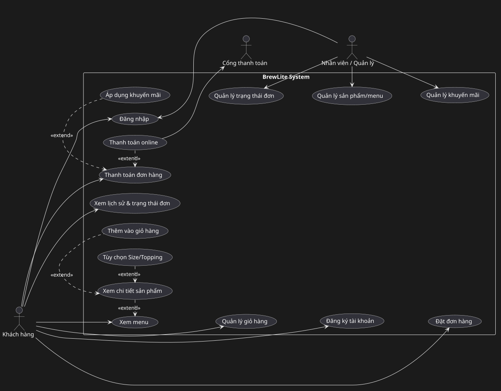

# Đặc tả Yêu cầu Phần mềm

## 1. Yêu cầu chức năng (Functional Requirements)

| Mã ID | Nhóm chức năng | Tên yêu cầu | Mức ưu tiên | Tiêu chí chấp nhận có thể kiểm chứng |
| :--- | :--- | :--- | :---: | :--- |
| **FR-01** | Menu | Hiển thị danh mục đồ uống | **Must** | - **Given** CSDL có sản phẩm hoạt động, **When** gọi `GET /products`, **Then** trả `200 OK` kèm mảng JSON `id`, `name`, `price`, `imageUrl`, `stock`. `stock` chỉ dùng để suy ra trạng thái còn/hết hàng. - UI lưới mobile-first, có `loading` (skeleton), `empty`, `error`. |
| **FR-02** | Chi tiết món | Xem chi tiết sản phẩm & Tùy chọn | **Must** | - **Given** chọn 1 sản phẩm, **When** gọi `GET /products/:id`, **Then** trả chi tiết + mô tả + danh sách Size (S, M, L kèm `priceDelta`) + danh sách Topping (kèm `price`). Size/Topping là bộ điều chỉnh giá, không có kho riêng; kho chỉ quản lý ở `Product.stock`. - UI cho chọn 1 Size, chọn nhiều Topping; tổng giá preview cập nhật tức thời (giá preview ở client không có giá trị pháp lý). |
| **FR-03** | Giỏ hàng | Quản lý giỏ hàng trên máy khách | **Must** | - Thêm sản phẩm kèm `{productId, size, toppingIds, qty}`; tăng/giảm số lượng, xóa từng món / xóa toàn bộ. - Công thức preview: $\sum (\text{giá cơ bản} + \text{giá size} + \sum \text{giá topping}) \times \text{số lượng}$. Server **bỏ qua** total client gửi. - Badge hiển thị đúng tổng số lượng; persist local state khi refresh. |
| **FR-04** | Xác thực | Đăng ký & Đăng nhập người dùng | **Must** | - `POST /auth/register`: email hợp lệ, mật khẩu tối thiểu 6 ký tự; băm Bcrypt (salt rounds `>=10`) trước khi lưu; email tồn tại trả `409 Conflict`. - `POST /auth/login`: đúng trả JWT chứa `userId`, `email`, `role` với expiry (vd 1h); sai trả `401 Unauthorized`. `role` load từ DB, không tin client. - Roles: `customer` (MVP), `staff` (dành cho KDS/Admin thuộc Extended Scope). `POST /orders`, `POST /payments`, `GET /orders/me` yêu cầu JWT Guard; thiếu/hết hạn `401`, sai quyền `403`. |
| **FR-05** | Đặt đơn | Tạo đơn hàng mới | **Must** | - **Given** đã đăng nhập và giỏ có tối thiểu 1 món, **When** gửi `POST /orders` với danh sách `{productId, size, toppingIds, qty, promoCode?}` (không gửi `total`), **Then** backend: kiểm tra JWT (`401` nếu thiếu), validate DTO bằng `class-validator`, validate `1 <= qty <= 20` / món, tự tính lại total từ DB. - Thực hiện Transaction + Optimistic/Pessimistic locking (`SELECT FOR UPDATE` / version) kiểm tra `stock`; đủ thì trừ kho và tạo `Order` trạng thái `PENDING` + `OrderItem`s, trả `orderId`. Thiếu hàng thì rollback toàn bộ, trả `400 Bad Request` kèm món hết hàng. - Client xóa giỏ **ngay sau khi tạo `PENDING` thành công**. Thử lại thanh toán dùng lại `orderId`, không dùng giỏ. |
| **FR-06** | Thanh toán | Thanh toán không tiền mặt (idempotent) | **Must** | - **Given** đơn ở `PENDING` **hoặc** `PAYMENT_FAILED` (được phép thử lại) thuộc sở hữu caller, **When** gửi `POST /payments {orderId, method, amount}` kèm header `Idempotency-Key` (UUID) + JWT, **Then**: check JWT, validate DTO, tra `Payment` theo scope `(userId, orderId, key)` — bản ghi `PROCESSING` chưa hết `expiresAt` trả `409 Conflict`, còn `PAID`/`FAILED`/`EXPIRED` trả kết quả đã lưu; **tuyệt đối không gọi gateway lần 2**. - **Khóa & chặn double-charge (kể cả khi client sinh key khác)**: mở Transaction và `SELECT Order ... FOR UPDATE` (khóa row đơn) để nối tiếp mọi thao tác thanh toán của cùng đơn. Trong cùng transaction: check `order.userId == jwt.userId` (ngược lại `403`), check `amount == order.totalAmount` (ngược lại `400`); nếu đơn `PAYMENT_FAILED` → `assertTransition(PAYMENT_FAILED -> PENDING)` (FR-08); nếu đơn ngoài `PENDING`/`PAYMENT_FAILED` (đã `PAID`/`CANCELLED`/...) → `400`. Nếu tồn tại `Payment` khác của đúng `orderId` đang `PROCESSING` chưa hết `expiresAt` (giao dịch trước còn treo / timeout chưa xác minh) → `409`, **không tạo giao dịch mới**; hợp lệ thì INSERT `Payment {userId, orderId, amount, method, idempotencyKey, expiresAt}` ở `PROCESSING` rồi COMMIT. UNIQUE `(userId, orderId, idempotencyKey)` chặn request đồng thời cùng key (vi phạm → đọc lại bản ghi, trả `409`/kết quả đã lưu). - **Gọi gateway** sau khi commit reservation: `createPayment(orderId, amount, method)` → nhận `transactionReference`. - **Thành công**: Transaction cập nhật `Payment -> PAID` (lưu `transactionReference`) và `PENDING -> PAID` qua `assertTransition` (FR-08), commit; **sau commit** gọi **FR-10** cộng loyalty 1 lần/đơn, rồi trả `200` kèm mã đơn + trạng thái. Kết quả cuối lưu cùng key để lần gọi trùng key trả lại kết quả cũ. - **Thất bại xác định** (gateway phản hồi lỗi rõ ràng): Transaction cập nhật `Payment -> FAILED` và `PENDING -> PAYMENT_FAILED` qua `assertTransition` (FR-08) — chắc chắn không trừ tiền. Thử lại: client sinh `Idempotency-Key` **mới** và gọi lại; bước check trạng thái tự `PAYMENT_FAILED -> PENDING` (FR-08) rồi thanh toán lại. - **Timeout / kết quả không xác định (chống double-charge)**: KHÔNG kết luận `FAILED` ngay vì gateway có thể đã trừ tiền. Gọi `Payment.verifyResult()` đối soát gateway theo `transactionReference`/key (hoặc chờ callback `verifyCallback`, RSK-03): xác minh *thất bại* → xử lý như "thất bại xác định"; xác minh *thành công* → xử lý như "thành công"; *chưa xác minh được* → giữ `Payment = PROCESSING` (kèm `expiresAt`), đơn vẫn `PENDING`, trả `409/202` "đang xác minh", **không cho thử lại bằng key mới** để tránh trừ tiền 2 lần. - **Phục hồi bản ghi treo**: `Payment` ở `PROCESSING` quá `expiresAt` và đối soát xác nhận gateway chưa trừ tiền → `markExpired()` chuyển `Payment -> EXPIRED` (đơn vẫn `PENDING`) để khách thử lại bằng key mới. Mọi nhánh trạng thái đều đi qua `assertTransition` (FR-08); FR-06 không tự định nghĩa transition riêng. (Lưu ý: Thời gian hết hạn giữ chỗ thanh toán mặc định là expiresAt = createdAt + 15 phút) |
| **FR-07** | Lịch sử đơn | Xem chi tiết & Lịch sử đơn hàng cá nhân | **Should** | - `GET /orders/me`: chỉ trả đơn của `jwt.userId`, sort mới nhất trước; luôn lọc theo `jwt.userId` nên không trả đơn của người khác; yêu cầu JWT, thiếu `401`. (Nếu bổ sung `GET /orders/:id` cho màn hình xác nhận thì trả `403` khi caller không sở hữu đơn.) - Màn hình xác nhận hiển thị mã đơn (`#xxxx` rút gọn từ UUID), thời gian đặt, món kèm topping, tổng đã thanh toán, trạng thái (`PENDING`, `PAID`, `PAYMENT_FAILED`, `PREPARING`, `READY`, `COMPLETED`, `CANCELLED`). |
| **FR-08** | Trạng thái đơn | Quản lý trạng thái xử lý đơn hàng (State Machine) | **Must** | - Là **nguồn duy nhất** định nghĩa transition. FR-06/FR-10 chỉ được gọi `assertTransition`, không tự định nghĩa transition riêng. Chuyển sai ném `400 Bad Request`. Bảng chuyển hợp lệ duy nhất: `PENDING -> PAID` (pay OK); `PENDING -> PAYMENT_FAILED` (pay lỗi **đã xác minh** — timeout chưa xác minh thì đơn giữ `PENDING`, xem FR-06); `PAYMENT_FAILED -> PENDING` (thử lại); `PENDING -> CANCELLED` (customer chủ động hủy; không auto-hủy theo timeout — xem Activity-01); `PAYMENT_FAILED -> CANCELLED` (customer hủy); `PAID -> CANCELLED` (staff hỗ trợ, refund ngoài MVP mock); `PAID -> PREPARING -> READY -> COMPLETED` (barista/KDS). - `COMPLETED`, `CANCELLED` là terminal. - Mọi nhánh chuyển sang `CANCELLED` khi kho đã bị trừ ở FR-05 (`PENDING -> CANCELLED`, `PAYMENT_FAILED -> CANCELLED`, `PAID -> CANCELLED`) đều phải hoàn kho; riêng đơn đã `PAID` thì hoàn thêm điểm đã cộng theo FR-10. Nhánh `PREPARING/READY/COMPLETED` thuộc Extended Scope (KDS), MVP bắt buộc implement guard + unit test chặn sai. |
| **FR-09** | Khuyến mãi | Áp dụng mã giảm giá | **Should** | - Client gửi `promoCode` trong `POST /orders`. Server validate: tồn tại, còn hạn, `usageLimit` global/per-user, `minOrder` thỏa. - Mỗi đơn tối đa 1 mã, không cộng dồn. Giảm theo % hoặc số tiền cố định nhưng chặn trần `discount = min(configuredDiscount, maxDiscount, subtotal)`; `total = max(0, subtotal - discount)`. - Lock row `Promotion` trong transaction chống redeem đồng thời; sai trả `400` rõ lý do. |
| **FR-10** | Tích điểm | Tích lũy điểm thưởng thành viên  **Should** | - Sau khi commit `PENDING -> PAID`, cộng điểm 1 lần/đơn theo tỷ lệ `10.000 VNĐ = 1 điểm` (giá trị quy đổi tham khảo `1 điểm = 500 VNĐ` cho luồng đổi điểm ngoài MVP). Tích điểm theo tỷ lệ 10.000 VNĐ = 1 điểm tính trên tổng tiền thực thanh toán (order.totalAmount), không tính trên subtotal trước giảm giá. Idempotent theo `orderId` qua bảng `LoyaltyTransaction`; retry `PAYMENT_FAILED -> PAID` không cộng 2 lần. - Hoàn/hủy đơn phải hoàn kho (mọi nhánh `CANCELLED` sau khi đã trừ kho — xem FR-08) và trừ điểm đã cộng nếu đơn đã `PAID`. Không cho `discount + điểm` làm total âm. |
| **FR-11** | Quản lý món | Cập nhật danh mục & trạng thái món (Extended) | **Could** | - Chỉ `role=staff` (gồm quản lý cửa hàng) được cập nhật sản phẩm / chuyển hết hàng; validate `price >= 0`, `stock >= 0`, ghi audit log. Menu customer refresh thấy tương ứng. Thuộc Extended Scope, ngoài MVP KDS/Admin. |
| **FR-12** | Vận chuyển | Giao hàng tận nơi | **Won't** | - Không làm giao hàng, phí ship, GPS, app tài xế. Chỉ pick-up tại quầy. |
| **FR-13** | Tiền mặt | Thanh toán tiền mặt tại quầy | **Won't** | - Không làm tiền mặt trong luồng online. Tôn chỉ 100% không tiền mặt. |
| **FR-14** | Vận hành | Health check & Seed | **Must** | - `GET /health` trả `200 {status: ok}` cho smoke test sau deploy (Task 5.2/5.3). - Có migration + seed tái tạo DB (`Product`, Size/Topping mẫu, `Promotion` mẫu). |

---

## 2. Yêu cầu phi chức năng (Non-Functional Requirements)

| Mã ID | Nhóm yêu cầu | Tên yêu cầu phi chức năng | Mức ưu tiên | Tiêu chí chấp nhận và chỉ số đo lường |
| :--- | :--- | :--- | :---: | :--- |
| **NFR-01** | Hiệu năng | Tốc độ phản hồi của hệ thống (Performance) | **Must** | - `GET /products` `< 500ms` với tối thiểu 100 sản phẩm mẫu. - Tạo đơn + thanh toán hoàn tất `< 1000ms` (không tính latency gateway mock). |
| **NFR-02** | Bảo mật | An toàn thông tin & Phân quyền (Security) | **Must** | - Mật khẩu băm Bcrypt (salt rounds `>= 10`), không lưu/log plaintext. - Thiếu/hết hạn JWT `401`; sai `role` `403`. - Mọi Request DTO validate qua `class-validator` + `ValidationPipe` chống SQLi/XSS. - Không commit secret; `.env` vào `.gitignore`. |
| **NFR-03** | Tính khả dụng | Trải nghiệm người dùng di động (Usability & PWA) | **Must** | - Mobile-First `360px-768px`, tương thích Chrome/Safari. - Feedback tức thời: skeleton/spinner, Toast thêm giỏ, Empty state giỏ/đơn trống. - PWA cơ bản (Manifest, theme color, icon). |
| **NFR-04** | Khả năng triển khai | Tự động hóa CI/CD & Đóng gói (Deployability) | **Must** | - `docker-compose.yml` chạy 3 dịch vụ web/api/db bằng 1 lệnh. - GitHub Actions trên PR: `Install -> Lint -> Unit Test -> Build`; fail thì cấm merge. - CD: build image tag `commit SHA/semver` -> push registry -> deploy bằng CI secret -> chạy migration an toàn -> `GET /health` smoke test; fail thì dừng + rollback theo `README`. Production HTTPS, DB không public trực tiếp. |
| **NFR-05** | Tính toàn vẹn | Nhất quán dữ liệu đồng thời & Idempotency | **Must** | - Transaction ACID khi tạo đơn/trừ kho: không có chuyện trừ kho mà mất đơn. - `SELECT FOR UPDATE` / optimistic locking: 5 khách tranh món cuối cùng thì chỉ 1 thành công, 4 còn lại `400` hết hàng. - `POST /payments` idempotent theo `(userId, orderId, Idempotency-Key)`: retry cùng key không trừ tiền 2 lần. - Chặn double-charge liên đơn/thời điểm: `SELECT Order FOR UPDATE` + guard "còn `Payment` khác đang `PROCESSING` cho cùng `orderId`" (xem FR-06) bảo đảm một đơn tối đa **1 giao dịch đang xử lý** tại một thời điểm. |

---

## 3. Sơ đồ Use Case Tổng quát Hệ thống (System Use Case Diagram)

