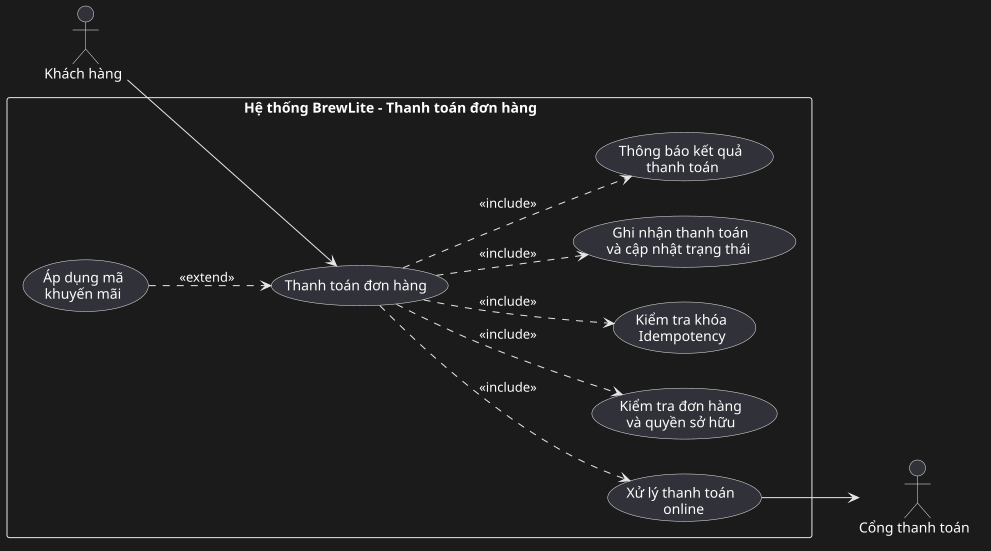

# Đặc tả Use Case Trọng tâm: Thanh toán Đơn hàng

## 1. Thông tin Use Case
* **Tên Use Case**: Thanh toán đơn hàng
* **Mã định danh**: `UC-08` 
* **Mức độ ưu tiên**: **Must Have** (Chức năng cốt lõi của MVP)
* **Actor chính**: Khách hàng (Customer)
* **Actor hỗ trợ**: Cổng thanh toán (Payment Gateway Service)

---

## 2. Tóm tắt nghiệp vụ
Use case này cho phép khách hàng thực hiện thanh toán trực tuyến không dùng tiền mặt (thông qua Ví điện tử hoặc Thẻ ngân hàng) cho một đơn hàng đã được tạo và đang ở trạng thái chờ thanh toán (`PENDING`). Hệ thống sử dụng cơ chế **Idempotency** (bằng `Idempotency-Key`) để ngăn chặn việc trừ tiền lặp lại khi người dùng bấm nhiều lần hoặc do mạng di động chập chờn. Khi cổng thanh toán xác nhận thành công, đơn hàng được chuyển trạng thái sang **`PAID`** và hiển thị thông tin xác nhận cho khách hàng; nếu thất bại, đơn chuyển sang **`PAYMENT_FAILED`** và cho phép khách hàng thử lại mà không phải tạo lại đơn mới.

---

## 3. Sơ đồ Use Case (Use Case Diagram)

Sơ đồ thể hiện phạm vi Use Case Thanh toán đơn hàng, liên kết với Actor và các Use Case thành phần:

---

## 4. Trigger (Sự kiện kích hoạt)
Khách hàng nhấn nút **"Xác nhận thanh toán"** trên màn hình Thanh toán (`/orders/:id/payment`).

---

## 5. Tiền điều kiện (Pre-conditions)
1. Khách hàng đã đăng nhập thành công vào hệ thống và sở hữu JWT Token còn hiệu lực.
2. Đơn hàng cần thanh toán đã tồn tại trong CSDL với trạng thái **`PENDING`**, thuộc quyền sở hữu của chính khách hàng đăng nhập, và có tổng số tiền hợp lệ ($> 0$).
3. Dịch vụ Cổng thanh toán mô phỏng (Payment Gateway Service) đang hoạt động và có thể tiếp nhận kết nối từ NestJS API.

---

## 6. Hậu điều kiện (Post-conditions)

### 6.1. Trường hợp thành công
* Bản ghi thanh toán mới (`Payment`) được khởi tạo trong CSDL lưu trữ: `id`, `orderId`, `amount`, `method`, `idempotencyKey` và thời gian thanh toán.
* Trạng thái đơn hàng trong bảng `Order` được cập nhật từ `PENDING` $\rightarrow$ **`PAID`**.
* Giỏ hàng đã được làm sạch từ bước tạo đơn (`POST /orders` -> `PENDING`); bước này không dùng giỏ nữa.
* Khách hàng nhận được thông báo giao dịch thành công kèm mã đơn hàng (ví dụ `#1042`), trạng thái `PAID` và lời mời nhận nước tại quầy.

### 6.2. Trường hợp thất bại
* Trạng thái đơn hàng chuyển sang **`PAYMENT_FAILED`**.
* Không có giao dịch trừ tiền nào được hoàn tất.
* Hệ thống thông báo rõ nguyên nhân thất bại và cung cấp nút **"Thử thanh toán lại"** cho đúng đơn hàng này mà không tạo thêm bản ghi đơn hàng trùng lặp.

---

## 7. Luồng sự kiện chính (Main Flow)

| Bước | Hành động của Actor (Khách hàng) | Phản hồi của Hệ thống (BrewLite System) |
| :---: | :--- | :--- |
| **1** | Khách hàng truy cập màn hình Thanh toán của đơn hàng vừa tạo (hoặc từ danh sách đơn chờ thanh toán). | Giao diện Next.js hiển thị thông tin đơn: Mã đơn, tổng số tiền cần trả và danh sách các phương thức thanh toán không tiền mặt (Ví điện tử MoMo/ZaloPay, Thẻ ngân hàng). |
| **2** | Khách hàng chọn phương thức thanh toán mong muốn (ví dụ: *Ví điện tử*). | Giao diện ghi nhận lựa chọn và kích hoạt nút "Xác nhận thanh toán". |
| **3** | Khách hàng nhấn nút **"Xác nhận thanh toán"**. | Client Next.js tự động tạo một mã duy nhất `Idempotency-Key` (chuẩn UUID v4). |
| **4** | | Client Next.js gửi yêu cầu `POST /payments` chứa: `orderId`, `method`, `amount` và header `Idempotency-Key` kèm JWT Bearer Token tới NestJS API. |
| **5** | | NestJS API (Payment Controller & Service): 1. Kiểm tra JWT Token và thẩm định dữ liệu đầu vào (`class-validator`). 2. Kiểm tra `Idempotency-Key` xem đã tồn tại giao dịch xử lý trước đó chưa. 3. Kiểm tra đơn hàng trong CSDL có đúng trạng thái `PENDING` và thuộc về user hiện tại hay không. |
| **6** | | NestJS API kích hoạt Use Case con **"Xử lý thanh toán online"**: Gọi API dịch vụ Cổng thanh toán mô phỏng (Mock Payment Gateway) để trừ tiền. |
| **7** | | Cổng thanh toán mô phỏng xử lý giao dịch an toàn và phản hồi trạng thái thành công (`SUCCESS`, Transaction ID). |
| **8** | | NestJS API mở Transaction: 1. Tạo bản ghi `Payment` với thông tin giao dịch và `Idempotency-Key`. 2. Cập nhật trạng thái đơn hàng từ `PENDING` $\rightarrow$ **`PAID`**. 3. Commit transaction và trả về phản hồi HTTP `200 OK` kèm thông tin đơn đã thanh toán. |
| **9** | Khách hàng xem màn hình xác nhận thanh toán thành công và nhận mã lấy nước. | Giao diện Next.js chuyển hướng khách hàng sang màn hình Xác nhận đơn (`/orders/:id/confirmation`), hiển thị mã đơn hàng, trạng thái `PAID` và thông điệp chuẩn bị đồ uống (giỏ hàng đã xóa từ lúc tạo đơn `PENDING`). |

---

## 8. Luồng thay thế (Alternative Flows)

### 8.1. Luồng AF-1: Áp dụng mã khuyến mãi (Extend UC - Áp dụng mã khuyến mãi)
* **Trước bước 1 (lúc tạo đơn):** khách hàng nhập mã giảm giá ở màn hình giỏ hàng; mã được gửi kèm trong `POST /orders` theo FR-09.
* **Hệ thống**: Kiểm tra mã hợp lệ, tính discount vào `order.total` trước khi tạo `PENDING`.
* Khách hàng thanh toán từ bước 1 với số tiền sau giảm giá; không sửa total khi đơn đã `PENDING`.

### 8.2. Luồng AF-2: Đổi phương thức thanh toán
* **Tại bước 2**: Khách hàng chuyển đổi từ *Ví điện tử* sang *Thẻ ngân hàng*. Hệ thống hiển thị form nhập thông tin thẻ mô phỏng tương ứng mà không làm thay đổi thông tin số tiền của đơn hàng.

---

## 9. Luồng ngoại lệ (Exception Flows)

### 9.1. Luồng EF-1: Phiên đăng nhập hết hạn (401 Unauthorized)
* **Tại bước 4 hoặc 5**: JWT token của khách hàng bị hết hạn hoặc không hợp lệ.
* **Hệ thống**: Trả về mã lỗi HTTP `401 Unauthorized`. Client chuyển hướng người dùng đến trang Đăng nhập và lưu lại `orderId` hiện tại để tự động quay lại thanh toán ngay sau khi đăng nhập thành công.

### 9.2. Luồng EF-2: Đơn hàng không ở trạng thái hợp lệ để thanh toán
* **Tại bước 5**: Đơn hàng đã ở trạng thái `PAID` (đã thanh toán rồi) hoặc `CANCELLED` (đã bị hủy). Riêng `PAYMENT_FAILED` được phép thử lại theo FR-08 (`PAYMENT_FAILED -> PENDING -> PAID`).
* **Hệ thống**: NestJS chặn lại với mã lỗi `400 Bad Request` kèm thông báo: *"Đơn hàng này không còn ở trạng thái chờ thanh toán"*. Không gọi sang cổng thanh toán.

### 9.3. Luồng EF-3: Cổng thanh toán báo lỗi hoặc giao dịch thất bại
* **Tại bước 7**: Tài khoản không đủ số dư, thông tin thanh toán sai hoặc cổng thanh toán bị timeout.
* **Hệ thống**: 
  1. Cập nhật trạng thái đơn hàng sang **`PAYMENT_FAILED`**.
  2. Ghi nhận log lỗi giao dịch.
  3. Trả về mã lỗi HTTP `400 / 502` cho client kèm thông báo nguyên nhân thất bại.
  4. Giao diện Next.js hiển thị thông báo lỗi và nút **"Thử thanh toán lại"** hoặc **"Chọn phương thức khác"**.

### 9.4. Luồng EF-4: Gửi lặp lại yêu cầu thanh toán
* **Tại bước 4**: Do đường truyền mạng chập chờn hoặc người dùng nhấn nút thanh toán nhiều lần liên tiếp, client gửi đi nhiều request với cùng một mã `Idempotency-Key`.
* **Hệ thống**:
  1. NestJS phát hiện `Idempotency-Key` này đã tồn tại trong CSDL:
     - Nếu giao dịch trước đó đang xử lý: Trả về trạng thái đang tiến hành (`409 Conflict` hoặc chờ kết quả).
     - Nếu giao dịch trước đó đã thành công: Trả về ngay kết quả giao dịch ban đầu (mã đơn, trạng thái `PAID`).
  2. Tuyệt đối không gửi lệnh trừ tiền sang Cổng thanh toán lần thứ 2.

---

## 10. Truy vết yêu cầu (Task 1.3)

`UC-08` bao phủ `FR-05` (đơn `PENDING` đầu vào), `FR-06` (luồng chính), `FR-09` (extend khuyến mãi), `NFR-02` (JWT + validate), `NFR-05` (transaction + idempotency). Sơ đồ nguồn `use-case-checkout.puml` dùng ID chuẩn `UC-08 / UC-09 / UC-08a..e` khớp `srs.md`.

